# Proyecto Semestral 2026 · TDFI103 Bases de Datos

## Fase 2: Implementación de Base de Datos y Producto Mínimo Viable asistido por IA

### Caso 1 · Sistema Integral de Gestión de Parques Naturales y Conservación Ambiental

> **Borrador para revisión del equipo.** Todo lo marcado como `[PENDIENTE]` debe completarlo el equipo con evidencia propia: capturas de ERDPlus, Workbench, PMV y Codespace, bitácoras y conclusiones individuales. Las salidas incluidas en la sección 7 provienen de la ejecución real del script durante la validación y sirven de referencia para comparar con las capturas.

## 1. Portada

| Integrante | Correo institucional |
|---|---|
| Carlos Vasconcellos | `[completar en la entrega de Canvas]` |
| Matias Lagos | `[completar en la entrega de Canvas]` |
| Esteban Gonzales | `[completar en la entrega de Canvas]` |
| Gaspar Galaz | `[completar en la entrega de Canvas]` |
| Francisca Perez | `[completar en la entrega de Canvas]` |

**Grupo:** 1 · **NRC:** 12142 · **Docente:** `[PENDIENTE]` · **Fecha de entrega:** `[PENDIENTE]`

> Integrantes y correos copiados del informe de Fase 1. `[PENDIENTE: confirmar que el equipo sigue siendo de cinco personas y corregir los correos si corresponde.]`

## 2. Descripción breve del caso y alcance de la Fase 2

El sistema organiza la información de parques naturales chilenos: sus áreas, la región donde se ubican, los recursos naturales (especies vegetales, animales y minerales) inventariados en cada área, el personal y sus funciones, los proyectos de investigación, y las excursiones con sus inscripciones y evaluaciones de visitantes.

En la Fase 2 el equipo corrigió el MERE y el modelo relacional de Fase 1, implementó la base `parques_db` en MySQL 8 con 24 tablas, la pobló con datos sintéticos reproducibles, resolvió doce requerimientos de información con 6 vistas y 6 procedimientos almacenados, y construyó un PMV en Python/Streamlit conectado a la misma base, con formulario transaccional de inscripción, CRUD de parques y especies, inicio de sesión con tres roles y un dashboard de cuatro preguntas. Se despliega con Docker Compose y también puede abrirse en GitHub Codespaces.

| Componente | Herramienta | Archivo principal |
|---|---|---|
| MERE | ERDPlus | `docs/mere/correcciones_mere.md` · `[PENDIENTE: MERE_corregido.png]` |
| Modelo relacional | MySQL Workbench | `docs/workbench/` |
| Motor | MySQL 8.0 | `sql/00_integral.sql` |
| Generación de datos | Python 3.12 + Faker | `scripts/generar_datos.py` |
| Acceso a datos | SQLAlchemy + PyMySQL | `app/db.py` |
| PMV | Streamlit + Pandas + Plotly | `app/main.py`, `app/negocio.py`, `app/seguridad.py` |
| Despliegue | Docker + Docker Compose (y GitHub Codespaces para desarrollo) | `Dockerfile`, `docker-compose.yml`, `.devcontainer/` |
| Asistente IA | OpenCode (obligatorio) | `docs/uso_ia_validacion.md` |

## 3. Correcciones a las reglas de negocio de la Fase 1

Se mantienen las 16 reglas de Fase 1. Las correcciones agregan reglas que la Fase 2 necesitaba y precisan otras que en Fase 1 no tenían cómo cumplirse en la base de datos:

| N.º | Regla | Relación con Fase 1 | Implementación |
|---|---|---|---|
| 5 | Cada parque tiene exactamente una región principal. | Se mantiene; ahora se controla. | Columna generada `principal_unica` + UNIQUE. |
| 9 | Una inscripción genera cero o una evaluación, y la evaluación pertenece a la misma excursión que la inscripción. | Precisada. | UNIQUE `id_inscripcion` + FK compuesta `(id_inscripcion, codigo_excursion)`. |
| 10 | Cada cuenta pertenece a un trabajador, tiene usuario único y contraseña con hash; solo las activas inician sesión. | Precisada. | `usuario` UNIQUE, `password_hash`, `activa`. |
| 17 | Cada función de un trabajador se ejerce en una o más áreas. | **Nueva** (necesaria para R8). | Tabla `ASIGNACION_TRABAJADOR`. |
| 19 | Roles válidos: ADMINISTRADOR, OPERADOR y ANALISTA; cada cuenta tiene al menos uno. | **Nueva**. | CHECK en `CUENTA_ROL.rol`; validación en el PMV. |
| 20 | Una excursión no admite más inscripciones que su capacidad. | **Nueva**. | Trigger `trg_insc_cupo_bi` + validación con bloqueo en el PMV. |
| 21 | La asistencia es INSCRITO hasta el día de la excursión; desde ese día puede ser ASISTIO o NO_ASISTIO. | **Nueva**. | CHECK de dominio + triggers `trg_insc_cupo_bi` y `trg_insc_estado_bu`. |
| 22 | Solo una inscripción con asistencia se evalúa, con fecha igual o posterior a la excursión. Calificación de 1 a 5. | **Nueva** (precisa la 9). | Trigger `trg_eval_bi` + CHECK. |
| 23 | Un parque o especie con registros asociados no se elimina: se desactiva. | **Nueva**. | Atributo `activo` en PARQUE y RECURSO_NATURAL. |
| 24 | Las excursiones se programan solo en áreas de acceso PUBLICO o RESTRINGIDO. | **Nueva**. | Aplicada en el poblamiento y en el formulario. |
| 25 | Las «comunidades administradoras» del enunciado corresponden a las regiones donde se ubica el parque, con su porcentaje territorial. | Adaptación territorial de Fase 1 (reglas 4 y 5). | `REGION` y `PARQUE_REGION`. |

## 4. MERE definitivo

`[PENDIENTE: insertar imagen legible del MERE corregido en ERDPlus — docs/mere/MERE_corregido.png]`

El MERE conserva las 15 entidades de Fase 1: siete regulares (PERSONA, CUENTA, REGION, PARQUE, EXCURSION, PROYECTO_CIENTIFICO y RECURSO_NATURAL), AREA como entidad débil de PARQUE, INSCRIPCION como asociativa, EVALUACION dependiente de EXCURSION y cinco subtipos (TRABAJADOR y VISITANTE de PERSONA, con especialización **total y solapada**; VEGETAL, ANIMAL y MINERAL de RECURSO_NATURAL, con especialización **parcial y disjunta**).

**Cambios respecto de Fase 1** (detalle y justificación en `docs/mere/correcciones_mere.md`):

1. **Nueva relación EJERCE_EN** (N:M) entre TRABAJADOR y AREA, cualificada por la función y con atributo `fecha_inicio`. Sin ella no era posible responder R8 («en qué parques o áreas desarrollan sus actividades»).
2. **CUENTA** incorpora `usuario`, `password_hash` y `fecha_creacion` para el inicio de sesión del PMV.
3. **PARQUE** y **RECURSO_NATURAL** incorporan `activo` para la desactivación lógica del CRUD.
4. Los identificadores se escriben sin tildes ni «ñ» (`anio_declaracion`, `dureza_mohs`) por portabilidad.

## 5. Modelo relacional final modelado en MySQL Workbench

`[PENDIENTE: insertar imagen del diagrama EER obtenido con Reverse Engineer — docs/workbench/modelo_relacional_final.png]` (procedimiento en `docs/workbench/instrucciones_workbench.md`).

El modelo tiene **24 tablas**: las 23 de Fase 1 más `ASIGNACION_TRABAJADOR`. Las claves compuestas de PARQUE `(anio_declaracion, nro_correlativo)` y AREA `(anio_declaracion, nro_correlativo, nro_area)` se referencian completas en EXCURSION, INVENTARIO_RECURSO, ESTUDIA, ASIGNACION_TRABAJADOR y PARQUE_REGION.

| Restricción | Cantidad | Ejemplos |
|---|---|---|
| PRIMARY KEY | 24 | compuestas en AREA, INVENTARIO_RECURSO, EVALUACION |
| FOREIGN KEY | 28 | FK compuesta EVALUACION → INSCRIPCION (C4) |
| UNIQUE | 12 | `(rut_persona, codigo_excursion)` en INSCRIPCION; `nombre_cientifico`; `usuario` |
| CHECK | 35 | calificación 1–5, formato de RUT, dominios de estados, superficie > 0 |
| Triggers | 8 | cupo/fechas de inscripción, cambio de asistencia, evaluación, disjunción VEGETAL/ANIMAL/MINERAL (3), supervisión (2) |

Decisiones de diseño relevantes:

- **ON DELETE RESTRICT** en las FK hacia PARQUE, AREA, EXCURSION y RECURSO_NATURAL: protege el historial; por eso el CRUD usa desactivación lógica. **CASCADE** solo en tablas que no tienen sentido sin su padre (teléfonos, roles, subtipos, asociaciones de proyectos).
- MySQL no admite CHECK sobre columnas que participan en una FK con acción referencial (error 3823). Por eso la regla «nadie se supervisa a sí mismo» se implementó con trigger.
- La especialización disjunta se controla con triggers, porque una FK no puede impedir que el mismo `id_recurso` esté en VEGETAL y ANIMAL a la vez.

## 6. Creación y poblamiento de la base de datos

**Creación.** `sql/01_estructura.sql` elimina y crea `parques_db` (utf8mb4, colación `utf8mb4_spanish_ci`), crea las tablas en orden de dependencia —primero las que no tienen FK— con todas sus restricciones y luego los triggers.

**Poblamiento.** `scripts/generar_datos.py` usa Faker (`es_CL`) con semilla fija 2026 y una fecha de referencia fija (10-11-2026), de modo que cada ejecución produce exactamente los mismos datos. Se usaron catálogos reales del dominio (16 parques, 98 especies chilenas con nombre científico, 20 minerales) y Faker para personas. Los RUT son ficticios, aunque con dígito verificador válido, y los correos usan el dominio reservado `correo.example`. Para que las consultas den resultados no triviales:

- Cada parque tiene una **popularidad** distinta y cada área una **tasa de asistencia** propia (62 %–96 %); las excursiones nocturnas tienen menos asistencia.
- Hay **más excursiones en verano** y menos en invierno; 6 % de las excursiones se llenan completas y 18 son futuras (estado INSCRITO) para usar el formulario.
- La **recurrencia** de visitantes sigue una distribución de Pareto: pocos visitantes frecuentes y muchos ocasionales (R11).
- La **evaluación** depende de la calidad propia de cada excursión y empeora en grupos grandes (R3).
- Cantidades inventariadas sesgadas: pocas áreas con abundancias muy altas (R6, R10).

El generador valida, antes de escribir, duplicados, FK, cupos, que solo se evalúe con asistencia, una región principal por parque y especialización disjunta. Luego escribe `sql/02_datos.sql` (INSERT masivos en una transacción) o, con `--cargar`, inserta con SQLAlchemy. `scripts/construir_integral.py` arma `sql/00_integral.sql` en el orden de la sección 8 del PDF. La carga pasa por todos los triggers sin errores.

| Tabla / tipo de dato (PDF) | Filas | Rango del PDF |
|---|---|---|
| REGION (comunidades administradoras) | 10 | 5–10 |
| PARQUE | 16 | 12–20 |
| AREA | 49 | 35–60 |
| RECURSO_NATURAL (especies) · 34 vegetales, 32 animales, 20 minerales, 12 sin clasificar | 98 | 60–120 |
| INVENTARIO_RECURSO | 435 | 250–500 |
| TRABAJADOR (personal) | 60 | 40–80 |
| PROYECTO_CIENTIFICO | 30 | 20–40 |
| VISITANTE | 240 | 150–300 |
| EXCURSION | 200 | 120–250 |
| INSCRIPCION · 987 ASISTIO, 250 NO_ASISTIO, 126 INSCRITO | 1.363 | 800–1.500 |
| EVALUACION | 604 | 400–900 |
| CUENTA (usuarios) · 6 ADMINISTRADOR, 20 OPERADOR, 31 ANALISTA | 50 | 40–80 |

Otras tablas: PERSONA 288, PERSONA_TELEFONO 312, TRABAJADOR_FUNCION 85, ASIGNACION_TRABAJADOR 165, CUENTA_ROL 58, PARQUE_REGION 18, PARTICIPA_PROYECTO 111, ESTUDIA 57, INVESTIGA 105, VEGETAL 34, ANIMAL 32, MINERAL 20.

**Validación.** `sql/05_pruebas.sql` comprueba conteos, especializaciones y 11 pruebas negativas que deben fallar con el error esperado (CHECK 3819, FK 1452/1451, UNIQUE 1062 y SIGNAL 1644 de los triggers), más una inscripción de prueba revertida con ROLLBACK.

`[PENDIENTE: captura de Workbench con el conteo por tabla y 2–3 pruebas negativas — docs/evidencias/wb_conteos.png, wb_pruebas_negativas.png]`

## 7. Requerimientos de información

Convención usada en todos los requerimientos: **visitantes** = inscripciones con `estado_asistencia = 'ASISTIO'` (participaciones; una persona que asiste a dos excursiones cuenta dos veces, criterio definido en Fase 1). El período se filtra por `EXCURSION.fecha`. Estas vistas y procedimientos **no se usan en el PMV**, según la sección 9 del PDF.


### R1 · Procedimiento almacenado

**Pregunta.** ¿Cuáles son las áreas con mayor cantidad de visitantes mediante excursiones durante un período determinado?

**Condición del enunciado.** Parámetros: fecha inicio y fecha término. Integra parque, área, excursión e inscripción.

**Código SQL de creación**

```sql
DELIMITER $$
CREATE PROCEDURE sp_r1_areas_mas_visitantes(IN p_inicio DATE, IN p_fin DATE)
BEGIN
  IF p_inicio IS NULL OR p_fin IS NULL OR p_inicio > p_fin THEN
    SIGNAL SQLSTATE '45000' SET MESSAGE_TEXT = 'Período inválido: fecha inicio debe ser <= fecha término';
  END IF;

  SELECT p.nombre                                AS parque,
         a.nro_area,
         a.nombre                                AS area,
         COUNT(DISTINCT e.codigo_excursion)      AS excursiones,
         COUNT(i.id_inscripcion)                 AS inscripciones,
         SUM(i.estado_asistencia = 'ASISTIO')    AS visitantes
  FROM PARQUE p
  JOIN AREA a        ON a.anio_declaracion = p.anio_declaracion
                    AND a.nro_correlativo  = p.nro_correlativo
  JOIN EXCURSION e   ON e.anio_declaracion = a.anio_declaracion
                    AND e.nro_correlativo  = a.nro_correlativo
                    AND e.nro_area         = a.nro_area
  JOIN INSCRIPCION i ON i.codigo_excursion = e.codigo_excursion
  WHERE e.fecha BETWEEN p_inicio AND p_fin
  GROUP BY p.anio_declaracion, p.nro_correlativo, p.nombre, a.nro_area, a.nombre
  ORDER BY visitantes DESC, excursiones DESC, parque, area;
END$$
DELIMITER ;
```

**Sentencia de consulta/ejecución**

```sql
CALL sp_r1_areas_mas_visitantes('2025-01-01', '2025-12-31');
```

**Captura de la salida en MySQL Workbench:** `[PENDIENTE: insertar docs/evidencias/wb_R1.png]`

Salida de referencia obtenida al validar el script (primeras 10 de 30 filas; comparar con la captura):

| parque            |   nro_area | area          |   excursiones |   inscripciones |   visitantes |
|:------------------|-----------:|:--------------|--------------:|----------------:|-------------:|
| Torres del Paine  |          1 | Mirador Norte |             5 |              64 |           58 |
| Villarrica        |          4 | Pampa         |             5 |              48 |           36 |
| Puyehue           |          1 | Valle Central |             3 |              29 |           27 |
| Villarrica        |          1 | Cascadas      |             4 |              33 |           21 |
| Nahuelbuta        |          1 | Valle Central |             2 |              22 |           21 |
| Radal Siete Tazas |          1 | Sector Volcán |             3 |              26 |           18 |
| Conguillío        |          2 | Laguna Verde  |             2 |              19 |           18 |
| Pan de Azúcar     |          2 | Laguna Verde  |             3 |              23 |           17 |
| La Campana        |          3 | Laguna Verde  |             4 |              18 |           14 |
| Conguillío        |          3 | Humedal       |             3 |              13 |           13 |

**Interpretación.** En 2025 el área Mirador Norte de Torres del Paine concentra la mayor cantidad de visitantes (58 asistencias en 5 excursiones), seguida por Pampa de Villarrica (36). El ranking muestra concentración: de 30 áreas con actividad, las cinco primeras reúnen el 44 % de los visitantes del año (163 de 369), lo que orienta dónde reforzar senderos, señalética y guardaparques.

### R2 · Vista

**Pregunta.** ¿Cómo se distribuyen las especies inventariadas entre vegetales, animales y minerales, considerando parque y área?

**Condición del enunciado.** Integra especie, especialización/tipo, inventario y área/parque.

**Código SQL de creación**

```sql
CREATE OR REPLACE VIEW vw_r2_distribucion_especies AS
SELECT p.anio_declaracion,
       p.nro_correlativo,
       p.nombre                         AS parque,
       a.nro_area,
       a.nombre                         AS area,
       CASE
         WHEN v.id_recurso IS NOT NULL THEN 'VEGETAL'
         WHEN an.id_recurso IS NOT NULL THEN 'ANIMAL'
         WHEN m.id_recurso IS NOT NULL THEN 'MINERAL'
         ELSE 'SIN_CLASIFICAR'
       END                              AS tipo_especie,
       COUNT(DISTINCT ir.id_recurso)    AS especies_distintas,
       SUM(ir.cantidad_inventariada)    AS cantidad_total
FROM INVENTARIO_RECURSO ir
JOIN RECURSO_NATURAL rn ON rn.id_recurso = ir.id_recurso
JOIN AREA a   ON a.anio_declaracion = ir.anio_declaracion
             AND a.nro_correlativo  = ir.nro_correlativo
             AND a.nro_area         = ir.nro_area
JOIN PARQUE p ON p.anio_declaracion = a.anio_declaracion
             AND p.nro_correlativo  = a.nro_correlativo
LEFT JOIN VEGETAL v  ON v.id_recurso  = rn.id_recurso
LEFT JOIN ANIMAL  an ON an.id_recurso = rn.id_recurso
LEFT JOIN MINERAL m  ON m.id_recurso  = rn.id_recurso
GROUP BY p.anio_declaracion, p.nro_correlativo, p.nombre,
         a.nro_area, a.nombre, tipo_especie;
```

**Sentencia de consulta/ejecución**

```sql
SELECT * FROM vw_r2_distribucion_especies ORDER BY parque, area, tipo_especie;
```

**Captura de la salida en MySQL Workbench:** `[PENDIENTE: insertar docs/evidencias/wb_R2.png]`

Salida de referencia obtenida al validar el script (primeras 10 de 167 filas; comparar con la captura):

|   anio_declaracion |   nro_correlativo | parque        |   nro_area | area          | tipo_especie   |   especies_distintas |   cantidad_total |
|-------------------:|------------------:|:--------------|-----------:|:--------------|:---------------|---------------------:|-----------------:|
|               1982 |                 2 | Alerce Andino |          1 | Cordón Sur    | ANIMAL         |                    5 |              675 |
|               1982 |                 2 | Alerce Andino |          1 | Cordón Sur    | MINERAL        |                    1 |               49 |
|               1982 |                 2 | Alerce Andino |          1 | Cordón Sur    | VEGETAL        |                    3 |            13858 |
|               1982 |                 2 | Alerce Andino |          3 | Laguna Verde  | ANIMAL         |                    3 |              365 |
|               1982 |                 2 | Alerce Andino |          3 | Laguna Verde  | MINERAL        |                    3 |              108 |
|               1982 |                 2 | Alerce Andino |          3 | Laguna Verde  | SIN_CLASIFICAR |                    1 |               32 |
|               1982 |                 2 | Alerce Andino |          3 | Laguna Verde  | VEGETAL        |                    4 |             3711 |
|               1982 |                 2 | Alerce Andino |          2 | Sector Volcán | ANIMAL         |                    5 |              315 |
|               1982 |                 2 | Alerce Andino |          2 | Sector Volcán | MINERAL        |                    2 |              100 |
|               1982 |                 2 | Alerce Andino |          2 | Sector Volcán | SIN_CLASIFICAR |                    1 |              172 |

**Interpretación.** La vista entrega, por parque y área, cuántas especies distintas hay de cada tipo y su cantidad total. En el conjunto, los vegetales dominan tanto en especies (157 registros área-especie) como en cantidad (≈ 276 mil individuos), mientras los minerales tienen pocas ocurrencias por área. Las 12 especies sin subtipo (hongos, líquenes y algas) aparecen como SIN_CLASIFICAR, coherente con la especialización parcial.

### R3 · Vista

**Pregunta.** ¿Existe relación entre la cantidad de visitantes de una excursión y su evaluación promedio?

**Condición del enunciado.** Integra excursión, inscripción y evaluación; incluye cantidad de participantes y promedio de evaluación.

**Código SQL de creación**

```sql
CREATE OR REPLACE VIEW vw_r3_visitantes_vs_evaluacion AS
SELECT e.codigo_excursion,
       e.fecha,
       e.modalidad,
       e.capacidad,
       COALESCE(ins.participantes, 0)   AS cantidad_participantes,
       COALESCE(ins.inscritos, 0)       AS cantidad_inscritos,
       COALESCE(ev.n_evaluaciones, 0)   AS cantidad_evaluaciones,
       ev.promedio_evaluacion
FROM EXCURSION e
LEFT JOIN (SELECT codigo_excursion,
                  COUNT(*)                                  AS inscritos,
                  SUM(estado_asistencia = 'ASISTIO')        AS participantes
             FROM INSCRIPCION
            GROUP BY codigo_excursion) ins
       ON ins.codigo_excursion = e.codigo_excursion
LEFT JOIN (SELECT codigo_excursion,
                  COUNT(*)                                  AS n_evaluaciones,
                  ROUND(AVG(calificacion), 2)               AS promedio_evaluacion
             FROM EVALUACION
            GROUP BY codigo_excursion) ev
       ON ev.codigo_excursion = e.codigo_excursion
WHERE e.fecha <= CURDATE();
```

**Sentencia de consulta/ejecución**

```sql
SELECT * FROM vw_r3_visitantes_vs_evaluacion ORDER BY cantidad_participantes DESC;
```

**Captura de la salida en MySQL Workbench:** `[PENDIENTE: insertar docs/evidencias/wb_R3.png]`

Salida de referencia obtenida al validar el script (primeras 10 de 182 filas; comparar con la captura):

| codigo_excursion   | fecha      | modalidad   |   capacidad |   cantidad_participantes |   cantidad_inscritos |   cantidad_evaluaciones |   promedio_evaluacion |
|:-------------------|:-----------|:------------|------------:|-------------------------:|---------------------:|------------------------:|----------------------:|
| EXC0092            | 2025-05-19 | AUTOGUIADA  |          30 |                       28 |                   30 |                      15 |                  2.67 |
| EXC0145            | 2026-02-09 | AUTOGUIADA  |          23 |                       22 |                   23 |                      13 |                  4.15 |
| EXC0074            | 2025-02-13 | AUTOGUIADA  |          21 |                       20 |                   21 |                      14 |                  2.93 |
| EXC0142            | 2026-01-16 | EDUCATIVA   |          24 |                       19 |                   21 |                       9 |                  2.67 |
| EXC0182            | 2026-11-05 | AUTOGUIADA  |          30 |                       19 |                   20 |                      11 |                  3.18 |
| EXC0072            | 2025-02-04 | AUTOGUIADA  |          28 |                       18 |                   18 |                       6 |                  2.67 |
| EXC0051            | 2024-11-11 | EDUCATIVA   |          20 |                       16 |                   16 |                      10 |                  2.6  |
| EXC0003            | 2024-01-15 | AUTOGUIADA  |          22 |                       15 |                   16 |                       9 |                  3.78 |
| EXC0006            | 2024-01-24 | EDUCATIVA   |          21 |                       14 |                   21 |                       9 |                  2.67 |
| EXC0132            | 2025-12-19 | EDUCATIVA   |          25 |                       14 |                   22 |                      10 |                  4.3  |

**Interpretación.** Con 163 excursiones evaluadas la correlación es negativa y débil (r = −0,16): hasta 15 participantes el promedio se mantiene cerca de 3,8–3,9, pero en los grupos de más de 15 cae a 3,0. El conteo y el promedio se calculan en subconsultas separadas para no duplicar filas en el JOIN; una excursión sin evaluaciones queda con promedio NULL, no 0.

### R4 · Procedimiento almacenado

**Pregunta.** ¿Qué parques concentran la mayor cantidad de excursiones y visitantes en un período determinado?

**Condición del enunciado.** Parámetros de fechas. Integra parque, área, excursión e inscripción.

**Código SQL de creación**

```sql
DELIMITER $$
CREATE PROCEDURE sp_r4_parques_excursiones_visitantes(IN p_inicio DATE, IN p_fin DATE)
BEGIN
  IF p_inicio IS NULL OR p_fin IS NULL OR p_inicio > p_fin THEN
    SIGNAL SQLSTATE '45000' SET MESSAGE_TEXT = 'Período inválido: fecha inicio debe ser <= fecha término';
  END IF;

  SELECT p.nombre                                              AS parque,
         COUNT(DISTINCT a.nro_area)                            AS areas_con_excursiones,
         COUNT(DISTINCT e.codigo_excursion)                    AS excursiones,
         COALESCE(SUM(i.estado_asistencia = 'ASISTIO'), 0)     AS visitantes,
         COUNT(i.id_inscripcion)                               AS inscripciones
  FROM PARQUE p
  JOIN AREA a          ON a.anio_declaracion = p.anio_declaracion
                      AND a.nro_correlativo  = p.nro_correlativo
  JOIN EXCURSION e     ON e.anio_declaracion = a.anio_declaracion
                      AND e.nro_correlativo  = a.nro_correlativo
                      AND e.nro_area         = a.nro_area
  LEFT JOIN INSCRIPCION i ON i.codigo_excursion = e.codigo_excursion
  WHERE e.fecha BETWEEN p_inicio AND p_fin
  GROUP BY p.anio_declaracion, p.nro_correlativo, p.nombre
  ORDER BY excursiones DESC, visitantes DESC;
END$$
DELIMITER ;
```

**Sentencia de consulta/ejecución**

```sql
CALL sp_r4_parques_excursiones_visitantes('2025-01-01', '2025-12-31');
```

**Captura de la salida en MySQL Workbench:** `[PENDIENTE: insertar docs/evidencias/wb_R4.png]`

Salida de referencia obtenida al validar el script (primeras 10 de 15 filas; comparar con la captura):

| parque                |   areas_con_excursiones |   excursiones |   visitantes |   inscripciones |
|:----------------------|------------------------:|--------------:|-------------:|----------------:|
| Villarrica            |                       4 |            13 |           76 |             111 |
| La Campana            |                       3 |            10 |           28 |              40 |
| Pan de Azúcar         |                       3 |             7 |           29 |              42 |
| Vicente Pérez Rosales |                       3 |             6 |           24 |              29 |
| Torres del Paine      |                       1 |             5 |           58 |              64 |
| Conguillío            |                       2 |             5 |           31 |              32 |
| Queulat               |                       3 |             5 |           13 |              23 |
| Puyehue               |                       2 |             4 |           30 |              34 |
| Chiloé                |                       1 |             4 |           11 |              16 |
| Nahuelbuta            |                       2 |             3 |           26 |              27 |

**Interpretación.** En 2025 Villarrica lidera en excursiones (13) y visitantes (76). Torres del Paine, con solo 5 excursiones, ocupa el segundo lugar en visitantes (58): concentra más público por salida. La diferencia entre ambos rankings muestra que más excursiones no implica necesariamente más visitantes.

### R5 · Vista

**Pregunta.** ¿Qué áreas presentan mayor tasa de asistencia respecto de las inscripciones realizadas?

**Condición del enunciado.** Integra parque, área, excursión e inscripción; calcula el porcentaje de asistencia.

**Código SQL de creación**

```sql
CREATE OR REPLACE VIEW vw_r5_tasa_asistencia_area AS
SELECT p.nombre                                     AS parque,
       a.nro_area,
       a.nombre                                     AS area,
       COUNT(DISTINCT e.codigo_excursion)           AS excursiones,
       COUNT(i.id_inscripcion)                      AS inscripciones,
       SUM(i.estado_asistencia = 'ASISTIO')         AS asistencias,
       ROUND(100 * SUM(i.estado_asistencia = 'ASISTIO') / COUNT(i.id_inscripcion), 2)
                                                    AS porcentaje_asistencia
FROM PARQUE p
JOIN AREA a        ON a.anio_declaracion = p.anio_declaracion
                  AND a.nro_correlativo  = p.nro_correlativo
JOIN EXCURSION e   ON e.anio_declaracion = a.anio_declaracion
                  AND e.nro_correlativo  = a.nro_correlativo
                  AND e.nro_area         = a.nro_area
JOIN INSCRIPCION i ON i.codigo_excursion = e.codigo_excursion
WHERE i.estado_asistencia IN ('ASISTIO', 'NO_ASISTIO')
GROUP BY p.anio_declaracion, p.nro_correlativo, p.nombre, a.nro_area, a.nombre;
```

**Sentencia de consulta/ejecución**

```sql
SELECT * FROM vw_r5_tasa_asistencia_area WHERE inscripciones >= 10 ORDER BY porcentaje_asistencia DESC;
```

**Captura de la salida en MySQL Workbench:** `[PENDIENTE: insertar docs/evidencias/wb_R5.png]`

Salida de referencia obtenida al validar el script (primeras 10 de 29 filas; comparar con la captura):

| parque           |   nro_area | area          |   excursiones |   inscripciones |   asistencias |   porcentaje_asistencia |
|:-----------------|-----------:|:--------------|--------------:|----------------:|--------------:|------------------------:|
| Pichasca         |          3 | Glaciar       |             2 |              13 |            13 |                  100    |
| Lauca            |          3 | Costa         |             3 |              16 |            16 |                  100    |
| Nahuelbuta       |          1 | Valle Central |             4 |              30 |            29 |                   96.67 |
| Conguillío       |          2 | Laguna Verde  |             6 |              51 |            48 |                   94.12 |
| La Campana       |          1 | Costa         |             4 |              28 |            26 |                   92.86 |
| Torres del Paine |          1 | Mirador Norte |            10 |              86 |            79 |                   91.86 |
| Huerquehue       |          1 | Quebrada Alta |             2 |              12 |            11 |                   91.67 |
| La Campana       |          4 | Glaciar       |            12 |              82 |            75 |                   91.46 |
| Nahuelbuta       |          4 | Quebrada Alta |             2 |              11 |            10 |                   90.91 |
| Conguillío       |          3 | Humedal       |             5 |              20 |            18 |                   90    |

**Interpretación.** La tasa considera solo excursiones ya realizadas (ASISTIO o NO_ASISTIO). Para evitar porcentajes engañosos con muestras pequeñas, la consulta filtra áreas con al menos 10 inscripciones: 29 áreas, con tasas entre 53 % y 100 %. Las áreas con menor tasa son candidatas a recordatorios o lista de espera para reducir cupos perdidos.

### R6 · Vista

**Pregunta.** ¿Qué especies presentan mayor cantidad inventariada por parque y área?

**Condición del enunciado.** Integra parque, área, inventario y especie.

**Código SQL de creación**

```sql
CREATE OR REPLACE VIEW vw_r6_especies_mayor_cantidad AS
SELECT p.nombre                     AS parque,
       a.nro_area,
       a.nombre                     AS area,
       rn.id_recurso,
       rn.nombre_comun,
       rn.nombre_cientifico,
       ir.cantidad_inventariada,
       ir.fecha_ultimo_monitoreo,
       RANK() OVER (PARTITION BY ir.anio_declaracion, ir.nro_correlativo, ir.nro_area
                    ORDER BY ir.cantidad_inventariada DESC) AS ranking_en_area
FROM INVENTARIO_RECURSO ir
JOIN RECURSO_NATURAL rn ON rn.id_recurso = ir.id_recurso
JOIN AREA a   ON a.anio_declaracion = ir.anio_declaracion
             AND a.nro_correlativo  = ir.nro_correlativo
             AND a.nro_area         = ir.nro_area
JOIN PARQUE p ON p.anio_declaracion = a.anio_declaracion
             AND p.nro_correlativo  = a.nro_correlativo
WHERE rn.activo = TRUE;
```

**Sentencia de consulta/ejecución**

```sql
SELECT * FROM vw_r6_especies_mayor_cantidad WHERE ranking_en_area = 1 ORDER BY parque, area;
```

**Captura de la salida en MySQL Workbench:** `[PENDIENTE: insertar docs/evidencias/wb_R6.png]`

Salida de referencia obtenida al validar el script (primeras 10 de 49 filas; comparar con la captura):

| parque            |   nro_area | area          |   id_recurso | nombre_comun     | nombre_cientifico     |   cantidad_inventariada | fecha_ultimo_monitoreo   |   ranking_en_area |
|:------------------|-----------:|:--------------|-------------:|:-----------------|:----------------------|------------------------:|:-------------------------|------------------:|
| Alerce Andino     |          1 | Cordón Sur    |           34 | Zarzamora        | Rubus ulmifolius      |                    5865 | 2026-09-04               |                 1 |
| Alerce Andino     |          3 | Laguna Verde  |            7 | Canelo           | Drimys winteri        |                    1525 | 2024-03-13               |                 1 |
| Alerce Andino     |          2 | Sector Volcán |           11 | Quillay          | Quillaja saponaria    |                    2986 | 2026-10-16               |                 1 |
| Bosque Fray Jorge |          2 | Cordón Sur    |           10 | Peumo            | Cryptocarya alba      |                    4693 | 2025-03-13               |                 1 |
| Bosque Fray Jorge |          1 | Mirador Norte |           59 | Ratón chinchilla | Abrocoma bennettii    |                      74 | 2025-02-12               |                 1 |
| Chiloé            |          2 | Humedal       |            6 | Palma chilena    | Jubaea chilensis      |                    3775 | 2026-09-30               |                 1 |
| Chiloé            |          1 | Sector Lago   |           14 | Calafate         | Berberis microphylla  |                    2363 | 2025-03-08               |                 1 |
| Conguillío        |          4 | Costa         |           17 | Siete camisas    | Escallonia rubra      |                    5587 | 2024-11-20               |                 1 |
| Conguillío        |          3 | Humedal       |           31 | Copihue          | Lapageria rosea       |                    2025 | 2024-11-09               |                 1 |
| Conguillío        |          2 | Laguna Verde  |            5 | Alerce           | Fitzroya cupressoides |                    4064 | 2026-01-22               |                 1 |

**Interpretación.** La vista ordena las especies de cada área con RANK(); al filtrar ranking_en_area = 1 se obtiene la especie dominante de cada una de las 49 áreas. En 45 de las 49 áreas domina un vegetal, como es esperable; en algunas el primer lugar lo ocupa una especie introducida (por ejemplo, zarzamora en Alerce Andino), información útil para planes de control.

### R7 · Vista

**Pregunta.** ¿Qué proyectos de investigación concentran mayor participación de investigadores y especies estudiadas?

**Condición del enunciado.** Integra proyecto, investigadores/personal y especies; usa funciones de grupo y HAVING.

**Código SQL de creación**

```sql
CREATE OR REPLACE VIEW vw_r7_proyectos_participacion AS
SELECT pc.id_proyecto,
       pc.nombre                        AS proyecto,
       pc.estado,
       COUNT(DISTINCT pp.rut_persona)   AS investigadores,
       COUNT(DISTINCT inv.id_recurso)   AS especies_estudiadas,
       COUNT(DISTINCT CONCAT_WS('-', es.anio_declaracion, es.nro_correlativo, es.nro_area))
                                        AS areas_estudiadas
FROM PROYECTO_CIENTIFICO pc
JOIN PARTICIPA_PROYECTO pp ON pp.id_proyecto = pc.id_proyecto
JOIN TRABAJADOR t          ON t.rut_persona  = pp.rut_persona
JOIN INVESTIGA inv         ON inv.id_proyecto = pc.id_proyecto
LEFT JOIN ESTUDIA es       ON es.id_proyecto = pc.id_proyecto
GROUP BY pc.id_proyecto, pc.nombre, pc.estado
HAVING COUNT(DISTINCT pp.rut_persona) >= 2
   AND COUNT(DISTINCT inv.id_recurso) >= 2;
```

**Sentencia de consulta/ejecución**

```sql
SELECT * FROM vw_r7_proyectos_participacion ORDER BY investigadores DESC, especies_estudiadas DESC;
```

**Captura de la salida en MySQL Workbench:** `[PENDIENTE: insertar docs/evidencias/wb_R7.png]`

Salida de referencia obtenida al validar el script (primeras 10 de 25 filas; comparar con la captura):

|   id_proyecto | proyecto                                                      | estado     |   investigadores |   especies_estudiadas |   areas_estudiadas |
|--------------:|:--------------------------------------------------------------|:-----------|-----------------:|----------------------:|-------------------:|
|             2 | Erosión y conservación de magnetita en Lauca                  | EN_CURSO   |                7 |                     7 |                  3 |
|            28 | Erosión y conservación de andesita en Nahuelbuta              | EN_CURSO   |                6 |                     5 |                  1 |
|            23 | Monitoreo de copao en Torres del Paine                        | EN_CURSO   |                6 |                     5 |                  1 |
|            22 | Fenología de culebra de cola larga en Vicente Pérez Rosales   | EN_CURSO   |                6 |                     4 |                  2 |
|             5 | Restauración del hábitat de ratón chinchilla en Alerce Andino | FINALIZADO |                5 |                     7 |                  3 |
|            12 | Erosión y conservación de calcita en Villarrica               | EN_CURSO   |                5 |                     5 |                  3 |
|             7 | Genética de quique en Lauca                                   | FINALIZADO |                5 |                     3 |                  1 |
|            20 | Impacto del turismo sobre barba de viejo en Alerce Andino     | EN_CURSO   |                5 |                     2 |                  3 |
|            17 | Cartografía de afloramientos de cuarzo en Lauca               | EN_CURSO   |                4 |                     6 |                  2 |
|            29 | Restauración del hábitat de siete camisas en Puyehue          | EN_CURSO   |                4 |                     6 |                  2 |

**Interpretación.** Con HAVING se conservan 25 de los 30 proyectos (al menos 2 investigadores y 2 especies). El de mayor participación reúne 7 investigadores y 7 especies en 3 áreas. COUNT(DISTINCT) evita que el cruce entre participantes y especies infle los conteos.

### R8 · Vista

**Pregunta.** ¿Qué trabajadores desempeñan más de una función y en qué parques o áreas desarrollan sus actividades?

**Condición del enunciado.** Integra personal, función/asignación y parque o área; usa funciones de grupo.

**Código SQL de creación**

```sql
CREATE OR REPLACE VIEW vw_r8_trabajadores_multifuncion AS
SELECT t.rut_persona,
       CONCAT(pe.nombres, ' ', pe.apellido_paterno)                 AS trabajador,
       t.cargo,
       COUNT(DISTINCT tf.funcion)                                   AS cantidad_funciones,
       GROUP_CONCAT(DISTINCT tf.funcion ORDER BY tf.funcion SEPARATOR ', ')       AS funciones,
       COUNT(DISTINCT p.nombre)                                     AS cantidad_parques,
       GROUP_CONCAT(DISTINCT p.nombre ORDER BY p.nombre SEPARATOR ', ')          AS parques,
       GROUP_CONCAT(DISTINCT CONCAT(p.nombre, ' / ', a.nombre)
                    ORDER BY p.nombre, a.nombre SEPARATOR '; ')     AS areas
FROM TRABAJADOR t
JOIN PERSONA pe            ON pe.rut_persona = t.rut_persona
JOIN TRABAJADOR_FUNCION tf ON tf.rut_persona = t.rut_persona
LEFT JOIN ASIGNACION_TRABAJADOR asg ON asg.rut_persona = tf.rut_persona
                                   AND asg.funcion     = tf.funcion
LEFT JOIN AREA a   ON a.anio_declaracion = asg.anio_declaracion
                  AND a.nro_correlativo  = asg.nro_correlativo
                  AND a.nro_area         = asg.nro_area
LEFT JOIN PARQUE p ON p.anio_declaracion = a.anio_declaracion
                  AND p.nro_correlativo  = a.nro_correlativo
GROUP BY t.rut_persona, pe.nombres, pe.apellido_paterno, t.cargo
HAVING COUNT(DISTINCT tf.funcion) > 1;
```

**Sentencia de consulta/ejecución**

```sql
SELECT * FROM vw_r8_trabajadores_multifuncion ORDER BY cantidad_funciones DESC, trabajador;
```

**Captura de la salida en MySQL Workbench:** `[PENDIENTE: insertar docs/evidencias/wb_R8.png]`

Salida de referencia obtenida al validar el script (primeras 10 de 29 filas; comparar con la captura):

| rut_persona   | trabajador                 | cargo                   |   cantidad_funciones | funciones                               |   cantidad_parques | parques                       | areas                                                                                                                          |
|:--------------|:---------------------------|:------------------------|---------------------:|:----------------------------------------|-------------------:|:------------------------------|:-------------------------------------------------------------------------------------------------------------------------------|
| 15620965-1    | Edison Robles              | Investigador            |                    3 | CONSERVACION, GUIA, INVESTIGACION       |                  1 | Radal Siete Tazas             | Radal Siete Tazas / Bosque Antiguo; Radal Siete Tazas / Sector Volcán                                                          |
| 13626000-6    | Isidora Eliana Ávila       | Guardaparque            |                    3 | GESTION, INVESTIGACION, VIGILANCIA      |                  1 | Huerquehue                    | Huerquehue / Humedal; Huerquehue / Quebrada Alta                                                                               |
| 18371460-0    | Luis Cisterna              | Técnico en conservación |                    3 | CONSERVACION, GESTION, INVESTIGACION    |                  2 | La Campana, Puyehue           | La Campana / Costa; Puyehue / Quebrada Alta; Puyehue / Valle Central                                                           |
| 16610139-5    | Mirta Elizabeth Águila     | Guardaparque            |                    3 | CONSERVACION, INVESTIGACION, VIGILANCIA |                  1 | Chiloé                        | Chiloé / Humedal; Chiloé / Sector Lago                                                                                         |
| 16263296-5    | Olga Sandra Navarro        | Investigador            |                    3 | CONSERVACION, GUIA, INVESTIGACION       |                  2 | Alerce Andino, La Campana     | Alerce Andino / Sector Volcán; La Campana / Costa; La Campana / Glaciar; La Campana / Laguna Verde; La Campana / Mirador Norte |
| 12239895-1    | Oscar Jiménez              | Técnico en conservación |                    3 | CONSERVACION, GUIA, VIGILANCIA          |                  2 | Lauca, Queulat                | Lauca / Bosque Antiguo; Lauca / Costa; Lauca / Mirador Norte; Queulat / Humedal                                                |
| 12408503-9    | Pedro Javier Soto          | Guardaparque            |                    3 | GESTION, GUIA, VIGILANCIA               |                  1 | Conguillío                    | Conguillío / Costa; Conguillío / Humedal; Conguillío / Laguna Verde; Conguillío / Quebrada Alta                                |
| 19089814-8    | Samuel Guillermo Gutiérrez | Administrador de parque |                    3 | GESTION, GUIA, INVESTIGACION            |                  1 | La Campana                    | La Campana / Glaciar; La Campana / Laguna Verde; La Campana / Mirador Norte                                                    |
| 19854874-K    | Alexander Bustamante       | Técnico en conservación |                    2 | CONSERVACION, INVESTIGACION             |                  1 | Pichasca                      | Pichasca / Cascadas; Pichasca / Glaciar; Pichasca / Sector Volcán                                                              |
| 12256081-3    | Alicia Araya               | Investigador            |                    2 | INVESTIGACION, VIGILANCIA               |                  2 | Bosque Fray Jorge, La Campana | Bosque Fray Jorge / Cordón Sur; Bosque Fray Jorge / Mirador Norte; La Campana / Laguna Verde                                   |

**Interpretación.** 29 de los 60 trabajadores ejercen más de una función; varios combinan tres (por ejemplo, conservación, guía e investigación). GROUP_CONCAT muestra los parques y áreas donde las ejercen: la mayoría trabaja en un solo parque, y algunos se reparten entre dos o tres, lo que ayuda a planificar turnos.

### R9 · Procedimiento almacenado

**Pregunta.** ¿Qué excursiones superan el promedio de visitantes de las excursiones realizadas en el mismo parque?

**Condición del enunciado.** Parámetros: parque y período. Subconsulta correlacionada; integra parque, área, excursión e inscripción.

**Código SQL de creación**

```sql
DELIMITER $$
CREATE PROCEDURE sp_r9_excursiones_sobre_promedio_parque(
  IN p_anio SMALLINT, IN p_correlativo SMALLINT, IN p_inicio DATE, IN p_fin DATE)
BEGIN
  IF p_inicio IS NULL OR p_fin IS NULL OR p_inicio > p_fin THEN
    SIGNAL SQLSTATE '45000' SET MESSAGE_TEXT = 'Período inválido: fecha inicio debe ser <= fecha término';
  END IF;

  SELECT x.parque, x.area, x.codigo_excursion, x.fecha, x.modalidad, x.visitantes,
         (SELECT ROUND(AVG(y.visitantes), 2)
            FROM (SELECT e2.codigo_excursion, e2.anio_declaracion, e2.nro_correlativo,
                         SUM(i2.estado_asistencia = 'ASISTIO') AS visitantes
                    FROM EXCURSION e2
                    JOIN INSCRIPCION i2 ON i2.codigo_excursion = e2.codigo_excursion
                   WHERE e2.fecha BETWEEN p_inicio AND p_fin
                   GROUP BY e2.codigo_excursion, e2.anio_declaracion, e2.nro_correlativo) y
           WHERE y.anio_declaracion = x.anio_declaracion
             AND y.nro_correlativo  = x.nro_correlativo)        AS promedio_parque
  FROM (SELECT p.anio_declaracion, p.nro_correlativo, p.nombre AS parque,
               a.nombre AS area, e.codigo_excursion, e.fecha, e.modalidad,
               SUM(i.estado_asistencia = 'ASISTIO') AS visitantes
          FROM PARQUE p
          JOIN AREA a        ON a.anio_declaracion = p.anio_declaracion
                            AND a.nro_correlativo  = p.nro_correlativo
          JOIN EXCURSION e   ON e.anio_declaracion = a.anio_declaracion
                            AND e.nro_correlativo  = a.nro_correlativo
                            AND e.nro_area         = a.nro_area
          JOIN INSCRIPCION i ON i.codigo_excursion = e.codigo_excursion
         WHERE e.fecha BETWEEN p_inicio AND p_fin
           AND (p_anio IS NULL OR (p.anio_declaracion = p_anio AND p.nro_correlativo = p_correlativo))
         GROUP BY p.anio_declaracion, p.nro_correlativo, p.nombre, a.nombre,
                  e.codigo_excursion, e.fecha, e.modalidad) x
  WHERE x.visitantes > (SELECT AVG(y.visitantes)
                          FROM (SELECT e2.anio_declaracion, e2.nro_correlativo,
                                       SUM(i2.estado_asistencia = 'ASISTIO') AS visitantes
                                  FROM EXCURSION e2
                                  JOIN INSCRIPCION i2 ON i2.codigo_excursion = e2.codigo_excursion
                                 WHERE e2.fecha BETWEEN p_inicio AND p_fin
                                 GROUP BY e2.codigo_excursion, e2.anio_declaracion, e2.nro_correlativo) y
                         WHERE y.anio_declaracion = x.anio_declaracion      -- correlación
                           AND y.nro_correlativo  = x.nro_correlativo)
  ORDER BY x.parque, x.visitantes DESC;
END$$
DELIMITER ;
```

**Sentencia de consulta/ejecución**

```sql
CALL sp_r9_excursiones_sobre_promedio_parque(1959, 1, '2024-01-01', '2026-11-10');
```

**Captura de la salida en MySQL Workbench:** `[PENDIENTE: insertar docs/evidencias/wb_R9.png]`

Salida de referencia obtenida al validar el script (primeras 3 de 3 filas; comparar con la captura):

| parque           | area          | codigo_excursion   | fecha      | modalidad   |   visitantes |   promedio_parque |
|:-----------------|:--------------|:-------------------|:-----------|:------------|-------------:|------------------:|
| Torres del Paine | Mirador Norte | EXC0092            | 2025-05-19 | AUTOGUIADA  |           28 |               7.9 |
| Torres del Paine | Mirador Norte | EXC0075            | 2025-02-13 | GUIADA      |           11 |               7.9 |
| Torres del Paine | Mirador Norte | EXC0105            | 2025-08-14 | GUIADA      |           10 |               7.9 |

**Interpretación.** Para Torres del Paine (1959-1) entre enero de 2024 y noviembre de 2026, el promedio del parque es 7,9 visitantes por excursión y tres excursiones lo superan; la mayor tuvo 28 asistentes. La subconsulta se recalcula para el parque de cada fila (correlación por anio_declaracion y nro_correlativo). Con parque NULL el procedimiento compara cada excursión con el promedio de su propio parque.

### R10 · Procedimiento almacenado

**Pregunta.** ¿Qué especies poseen una cantidad inventariada superior al promedio de las especies de su mismo tipo?

**Condición del enunciado.** Parámetro: tipo de especie. Integra especie, inventario, área y parque; usa subconsulta.

**Código SQL de creación**

```sql
DELIMITER $$
CREATE PROCEDURE sp_r10_especies_sobre_promedio_tipo(IN p_tipo VARCHAR(20))
BEGIN
  IF p_tipo NOT IN ('VEGETAL','ANIMAL','MINERAL','SIN_CLASIFICAR') OR p_tipo IS NULL THEN
    SIGNAL SQLSTATE '45000' SET MESSAGE_TEXT = 'Tipo inválido: use VEGETAL, ANIMAL, MINERAL o SIN_CLASIFICAR';
  END IF;

  SELECT rn.id_recurso,
         rn.nombre_comun,
         rn.nombre_cientifico,
         p_tipo                                    AS tipo_especie,
         SUM(ir.cantidad_inventariada)             AS cantidad_total,
         COUNT(DISTINCT CONCAT_WS('-', a.anio_declaracion, a.nro_correlativo, a.nro_area)) AS areas,
         COUNT(DISTINCT p.nombre)                  AS parques,
         GROUP_CONCAT(DISTINCT p.nombre ORDER BY p.nombre SEPARATOR ', ') AS presente_en
  FROM RECURSO_NATURAL rn
  JOIN INVENTARIO_RECURSO ir ON ir.id_recurso = rn.id_recurso
  JOIN AREA a   ON a.anio_declaracion = ir.anio_declaracion
               AND a.nro_correlativo  = ir.nro_correlativo
               AND a.nro_area         = ir.nro_area
  JOIN PARQUE p ON p.anio_declaracion = a.anio_declaracion
               AND p.nro_correlativo  = a.nro_correlativo
  WHERE (CASE WHEN EXISTS (SELECT 1 FROM VEGETAL v WHERE v.id_recurso = rn.id_recurso) THEN 'VEGETAL'
              WHEN EXISTS (SELECT 1 FROM ANIMAL  x WHERE x.id_recurso = rn.id_recurso) THEN 'ANIMAL'
              WHEN EXISTS (SELECT 1 FROM MINERAL m WHERE m.id_recurso = rn.id_recurso) THEN 'MINERAL'
              ELSE 'SIN_CLASIFICAR' END) = p_tipo
  GROUP BY rn.id_recurso, rn.nombre_comun, rn.nombre_cientifico
  HAVING SUM(ir.cantidad_inventariada) >
         (SELECT AVG(t.total)
            FROM (SELECT ir2.id_recurso, SUM(ir2.cantidad_inventariada) AS total
                    FROM INVENTARIO_RECURSO ir2
                    JOIN RECURSO_NATURAL rn2 ON rn2.id_recurso = ir2.id_recurso
                   WHERE (CASE WHEN EXISTS (SELECT 1 FROM VEGETAL v WHERE v.id_recurso = rn2.id_recurso) THEN 'VEGETAL'
                               WHEN EXISTS (SELECT 1 FROM ANIMAL  x WHERE x.id_recurso = rn2.id_recurso) THEN 'ANIMAL'
                               WHEN EXISTS (SELECT 1 FROM MINERAL m WHERE m.id_recurso = rn2.id_recurso) THEN 'MINERAL'
                               ELSE 'SIN_CLASIFICAR' END) = p_tipo
                   GROUP BY ir2.id_recurso) t)
  ORDER BY cantidad_total DESC;
END$$
DELIMITER ;
```

**Sentencia de consulta/ejecución**

```sql
CALL sp_r10_especies_sobre_promedio_tipo('ANIMAL');
```

**Captura de la salida en MySQL Workbench:** `[PENDIENTE: insertar docs/evidencias/wb_R10.png]`

Salida de referencia obtenida al validar el script (primeras 10 de 11 filas; comparar con la captura):

|   id_recurso | nombre_comun          | nombre_cientifico        | tipo_especie   |   cantidad_total |   areas |   parques | presente_en                                                                                                             |
|-------------:|:----------------------|:-------------------------|:---------------|-----------------:|--------:|----------:|:------------------------------------------------------------------------------------------------------------------------|
|           45 | Carpintero negro      | Campephilus magellanicus | ANIMAL         |             1504 |       6 |         5 | Lauca, Nahuelbuta, Pan de Azúcar, Puyehue, Torres del Paine                                                             |
|           59 | Ratón chinchilla      | Abrocoma bennettii       | ANIMAL         |             1482 |       9 |         8 | Alerce Andino, Bosque Fray Jorge, Conguillío, Lauca, Pan de Azúcar, Torres del Paine, Vicente Pérez Rosales, Villarrica |
|           60 | Vizcacha              | Lagidium viscacia        | ANIMAL         |             1471 |      10 |         7 | Chiloé, Conguillío, Huerquehue, Pichasca, Puyehue, Queulat, Vicente Pérez Rosales                                       |
|           40 | Cóndor andino         | Vultur gryphus           | ANIMAL         |             1145 |       7 |         7 | Alerce Andino, Huerquehue, Nahuelbuta, Pan de Azúcar, Queulat, Vicente Pérez Rosales, Villarrica                        |
|           47 | Flamenco chileno      | Phoenicopterus chilensis | ANIMAL         |             1060 |       5 |         5 | Alerce Andino, Chiloé, Conguillío, La Campana, Queulat                                                                  |
|           46 | Ñandú                 | Rhea pennata             | ANIMAL         |              762 |       7 |         7 | Alerce Andino, Conguillío, Lauca, Pichasca, Puyehue, Queulat, Vicente Pérez Rosales                                     |
|           53 | Hued-hued             | Pteroptochos tarnii      | ANIMAL         |              663 |       8 |         6 | Alerce Andino, Chiloé, La Campana, Lauca, Queulat, Radal Siete Tazas                                                    |
|           52 | Picaflor chico        | Sephanoides sephaniodes  | ANIMAL         |              610 |       7 |         5 | Bosque Fray Jorge, Huerquehue, La Campana, Pan de Azúcar, Torres del Paine                                              |
|           39 | Pudú                  | Pudu puda                | ANIMAL         |              602 |       3 |         3 | Alerce Andino, Conguillío, Torres del Paine                                                                             |
|           57 | Culebra de cola larga | Philodryas chamissonis   | ANIMAL         |              591 |       3 |         3 | Bosque Fray Jorge, La Campana, Vicente Pérez Rosales                                                                    |

**Interpretación.** Para ANIMAL, 11 especies superan el promedio de su tipo; lideran el carpintero negro (1.504 individuos en 5 parques), el ratón chinchilla y la vizcacha. El resultado indica además en cuántas áreas y parques está presente cada especie, lo que distingue abundancia concentrada de abundancia distribuida.

### R11 · Procedimiento almacenado

**Pregunta.** ¿Qué visitantes han participado en más excursiones que el promedio y además poseen una evaluación promedio superior al promedio general?

**Condición del enunciado.** Parámetros: rango de fechas. Integra visitante, inscripción, excursión y evaluación.

**Código SQL de creación**

```sql
DELIMITER $$
CREATE PROCEDURE sp_r11_visitantes_destacados(IN p_inicio DATE, IN p_fin DATE)
BEGIN
  IF p_inicio IS NULL OR p_fin IS NULL OR p_inicio > p_fin THEN
    SIGNAL SQLSTATE '45000' SET MESSAGE_TEXT = 'Período inválido: fecha inicio debe ser <= fecha término';
  END IF;

  SELECT v.rut_persona,
         CONCAT(pe.nombres, ' ', pe.apellido_paterno)  AS visitante,
         COUNT(DISTINCT i.codigo_excursion)            AS excursiones,
         ROUND(AVG(ev.calificacion), 2)                AS evaluacion_promedio,
         (SELECT ROUND(AVG(c.n), 2)
            FROM (SELECT i2.rut_persona, COUNT(*) AS n
                    FROM INSCRIPCION i2
                    JOIN EXCURSION e2 ON e2.codigo_excursion = i2.codigo_excursion
                   WHERE i2.estado_asistencia = 'ASISTIO'
                     AND e2.fecha BETWEEN p_inicio AND p_fin
                   GROUP BY i2.rut_persona) c)         AS promedio_excursiones,
         (SELECT ROUND(AVG(ev3.calificacion), 2)
            FROM EVALUACION ev3
            JOIN EXCURSION e3 ON e3.codigo_excursion = ev3.codigo_excursion
           WHERE e3.fecha BETWEEN p_inicio AND p_fin)  AS promedio_general
  FROM VISITANTE v
  JOIN PERSONA pe     ON pe.rut_persona = v.rut_persona
  JOIN INSCRIPCION i  ON i.rut_persona = v.rut_persona AND i.estado_asistencia = 'ASISTIO'
  JOIN EXCURSION e    ON e.codigo_excursion = i.codigo_excursion
  LEFT JOIN EVALUACION ev ON ev.id_inscripcion = i.id_inscripcion
  WHERE e.fecha BETWEEN p_inicio AND p_fin
  GROUP BY v.rut_persona, pe.nombres, pe.apellido_paterno
  HAVING COUNT(DISTINCT i.codigo_excursion) >
           (SELECT AVG(c.n)
              FROM (SELECT i2.rut_persona, COUNT(*) AS n
                      FROM INSCRIPCION i2
                      JOIN EXCURSION e2 ON e2.codigo_excursion = i2.codigo_excursion
                     WHERE i2.estado_asistencia = 'ASISTIO'
                       AND e2.fecha BETWEEN p_inicio AND p_fin
                     GROUP BY i2.rut_persona) c)
     AND AVG(ev.calificacion) >
           (SELECT AVG(ev3.calificacion)
              FROM EVALUACION ev3
              JOIN EXCURSION e3 ON e3.codigo_excursion = ev3.codigo_excursion
             WHERE e3.fecha BETWEEN p_inicio AND p_fin)
  ORDER BY excursiones DESC, evaluacion_promedio DESC;
END$$
DELIMITER ;
```

**Sentencia de consulta/ejecución**

```sql
CALL sp_r11_visitantes_destacados('2024-01-01', '2026-11-10');
```

**Captura de la salida en MySQL Workbench:** `[PENDIENTE: insertar docs/evidencias/wb_R11.png]`

Salida de referencia obtenida al validar el script (primeras 10 de 40 filas; comparar con la captura):

| rut_persona   | visitante                   |   excursiones |   evaluacion_promedio |   promedio_excursiones |   promedio_general |
|:--------------|:----------------------------|--------------:|----------------------:|-----------------------:|-------------------:|
| 16877015-4    | Noelia Gloria Torres        |            25 |                  3.81 |                   4.45 |               3.77 |
| 24711726-1    | Sergio Nelson Venegas       |            21 |                  4.24 |                   4.45 |               3.77 |
| 15202876-8    | Valentina Anahis Montenegro |            19 |                  3.88 |                   4.45 |               3.77 |
| 26247842-4    | María Guajardo              |            11 |                  3.88 |                   4.45 |               3.77 |
| 15254322-0    | Andrés Muñoz                |             9 |                  4.2  |                   4.45 |               3.77 |
| 20847199-6    | Carolina González           |             9 |                  4    |                   4.45 |               3.77 |
| 13427231-7    | Daniel Jorge Aliaga         |             8 |                  3.86 |                   4.45 |               3.77 |
| 23832959-0    | Rosa Aída León              |             8 |                  3.8  |                   4.45 |               3.77 |
| 19384266-6    | Vicente Cornejo             |             7 |                  4.5  |                   4.45 |               3.77 |
| 9852929-2     | Alison Fernanda Zúñiga      |             7 |                  4.33 |                   4.45 |               3.77 |

**Interpretación.** Entre enero de 2024 y noviembre de 2026 el promedio es 4,45 excursiones por visitante y la evaluación general 3,77. Cumplen ambas condiciones 40 visitantes: son el público frecuente y satisfecho, útil para programas de fidelización o voluntariado. Las columnas de promedio permiten verificar el criterio en la misma salida.

### R12 · Procedimiento almacenado

**Pregunta.** ¿Qué parques presentan un promedio de visitantes por excursión superior al promedio general de los parques durante un período?

**Condición del enunciado.** Parámetros: fecha inicio y fecha término. Integra parque, área, excursión e inscripción; usa subconsulta y agrupación.

**Código SQL de creación**

```sql
DELIMITER $$
CREATE PROCEDURE sp_r12_parques_sobre_promedio_general(IN p_inicio DATE, IN p_fin DATE)
BEGIN
  IF p_inicio IS NULL OR p_fin IS NULL OR p_inicio > p_fin THEN
    SIGNAL SQLSTATE '45000' SET MESSAGE_TEXT = 'Período inválido: fecha inicio debe ser <= fecha término';
  END IF;

  SELECT pq.parque,
         pq.excursiones,
         pq.visitantes,
         ROUND(pq.promedio_visitantes, 2)                   AS promedio_visitantes_excursion,
         ROUND((SELECT AVG(g.prom)
                  FROM (SELECT AVG(ex.visitantes) AS prom
                          FROM (SELECT e.anio_declaracion, e.nro_correlativo, e.codigo_excursion,
                                       SUM(i.estado_asistencia = 'ASISTIO') AS visitantes
                                  FROM EXCURSION e
                                  JOIN INSCRIPCION i ON i.codigo_excursion = e.codigo_excursion
                                 WHERE e.fecha BETWEEN p_inicio AND p_fin
                                 GROUP BY e.anio_declaracion, e.nro_correlativo, e.codigo_excursion) ex
                         GROUP BY ex.anio_declaracion, ex.nro_correlativo) g), 2)
                                                            AS promedio_general_parques
  FROM (SELECT p.nombre AS parque,
               COUNT(*)              AS excursiones,
               SUM(ex.visitantes)    AS visitantes,
               AVG(ex.visitantes)    AS promedio_visitantes
          FROM PARQUE p
          JOIN (SELECT e.anio_declaracion, e.nro_correlativo, e.codigo_excursion,
                       SUM(i.estado_asistencia = 'ASISTIO') AS visitantes
                  FROM AREA a
                  JOIN EXCURSION e   ON e.anio_declaracion = a.anio_declaracion
                                    AND e.nro_correlativo  = a.nro_correlativo
                                    AND e.nro_area         = a.nro_area
                  JOIN INSCRIPCION i ON i.codigo_excursion = e.codigo_excursion
                 WHERE e.fecha BETWEEN p_inicio AND p_fin
                 GROUP BY e.anio_declaracion, e.nro_correlativo, e.codigo_excursion) ex
            ON ex.anio_declaracion = p.anio_declaracion
           AND ex.nro_correlativo  = p.nro_correlativo
         GROUP BY p.anio_declaracion, p.nro_correlativo, p.nombre) pq
  WHERE pq.promedio_visitantes >
        (SELECT AVG(g.prom)
           FROM (SELECT AVG(ex.visitantes) AS prom
                   FROM (SELECT e.anio_declaracion, e.nro_correlativo, e.codigo_excursion,
                                SUM(i.estado_asistencia = 'ASISTIO') AS visitantes
                           FROM EXCURSION e
                           JOIN INSCRIPCION i ON i.codigo_excursion = e.codigo_excursion
                          WHERE e.fecha BETWEEN p_inicio AND p_fin
                          GROUP BY e.anio_declaracion, e.nro_correlativo, e.codigo_excursion) ex
                  GROUP BY ex.anio_declaracion, ex.nro_correlativo) g)
  ORDER BY promedio_visitantes_excursion DESC;
END$$
DELIMITER ;
```

**Sentencia de consulta/ejecución**

```sql
CALL sp_r12_parques_sobre_promedio_general('2025-01-01', '2025-12-31');
```

**Captura de la salida en MySQL Workbench:** `[PENDIENTE: insertar docs/evidencias/wb_R12.png]`

Salida de referencia obtenida al validar el script (primeras 7 de 7 filas; comparar con la captura):

| parque            |   excursiones |   visitantes |   promedio_visitantes_excursion |   promedio_general_parques |
|:------------------|--------------:|-------------:|--------------------------------:|---------------------------:|
| Torres del Paine  |             5 |           58 |                           11.6  |                       5.18 |
| Nahuelbuta        |             3 |           26 |                            8.67 |                       5.18 |
| Huerquehue        |             1 |            8 |                            8    |                       5.18 |
| Puyehue           |             4 |           30 |                            7.5  |                       5.18 |
| Conguillío        |             5 |           31 |                            6.2  |                       5.18 |
| Radal Siete Tazas |             3 |           18 |                            6    |                       5.18 |
| Villarrica        |            13 |           76 |                            5.85 |                       5.18 |

**Interpretación.** En 2025 el promedio general de los parques es 5,18 visitantes por excursión y 7 parques lo superan, encabezados por Torres del Paine (11,6). Se agrupa en dos niveles —primero por excursión, luego por parque— y el promedio general es el promedio de los promedios de cada parque.


## 8. Diseño del PMV y explicación de sus cuatro funcionalidades

El PMV es una única aplicación Streamlit conectada a la misma base `parques_db`. Está separada en tres capas para que cada regla viva en un solo lugar:

```text
Usuario (navegador)
   │  formularios, filtros y gráficos
   ▼
app/main.py ........ Interfaz Streamlit: páginas, menú según rol, gráficos Plotly
   │  llama funciones de negocio pasando la sesión
   ▼
app/negocio.py ..... Reglas: validaciones, permisos (exigir_permiso), transacciones
app/seguridad.py ... Hash PBKDF2 de contraseñas, roles y permisos
   │  SQL parametrizado (sin concatenar datos del usuario)
   ▼
app/db.py .......... SQLAlchemy + PyMySQL; credenciales desde variables de entorno
   │
   ▼
MySQL 8 · parques_db  (FK, UNIQUE, CHECK y triggers: última línea de defensa)
```

**Recorrido de una inscripción.** El operador elige una excursión y un visitante y presiona «Inscribir visitante» → `main.py` llama a `inscribir_visitante(sesion, rut, codigo, estado, obs)` → `negocio.py` verifica el permiso y el RUT, abre una transacción (`engine.begin()`) y bloquea la fila de la excursión con `SELECT … FOR UPDATE` → valida que exista, que no sea pasada, que el área esté operativa, que el visitante exista, que no esté duplicado y que haya cupo → calcula el siguiente `id_inscripcion` e inserta → MySQL aplica FK, UNIQUE, CHECK y el trigger de cupo → si todo está bien hay COMMIT y la pantalla muestra «Inscripción INS… registrada»; si algo falla hay ROLLBACK automático y la pantalla muestra el motivo.

### 8.1 Formulario transaccional · inscripción de visitante en excursión

- Solo se ofrecen excursiones **existentes**, desde hoy en adelante, en áreas operativas de parques activos, con la ocupación visible (inscritos/capacidad).
- El visitante se busca por RUT, nombre o apellido y se elige de una lista: no se escriben claves a mano.
- Estado de asistencia: en excursiones futuras solo INSCRITO; desde el día de la excursión, también ASISTIO o NO_ASISTIO. La pestaña «Registrar asistencia» actualiza en **una sola transacción** la asistencia de las excursiones realizadas.
- Validaciones en dos niveles: en Python (mensajes claros) y en MySQL (triggers y restricciones), por si la base se modifica por otra vía.
- El bloqueo `FOR UPDATE` evita que dos operadores ocupen el último cupo al mismo tiempo.

### 8.2 CRUD de tablas maestras · PARQUE y ESPECIE (RECURSO_NATURAL + subtipo)

| Operación | Parque | Especie |
|---|---|---|
| Crear | Parque + región principal + primera área en una transacción (reglas: al menos un área y exactamente una región principal). El correlativo se calcula por año. | Recurso + fila del subtipo (VEGETAL, ANIMAL o MINERAL) en una transacción; SIN_CLASIFICAR no crea subtipo. |
| Consultar | Tabla con región principal y número de áreas; opción de ver desactivados. | Tabla con tipo, atributos del subtipo y registros de inventario; filtro por tipo. |
| Modificar | Todos los campos salvo la clave; la fecha debe mantener el año de la clave. | Campos comunes y del subtipo; el tipo no cambia, para respetar la especialización disjunta. |
| Eliminar | **Física** si no tiene excursiones, inventario, asignaciones ni estudios; si los tiene, **desactivación lógica** (`activo = FALSE`), reversible. | **Física** si no tiene inventario ni proyectos; si los tiene, desactivación lógica. |

### 8.3 Control de usuarios · inicio de sesión y roles

Las contraseñas se guardan con hash PBKDF2-SHA256 y sal propia por cuenta; la verificación usa comparación en tiempo constante. Solo inician sesión las cuentas activas con al menos un rol.

| Funcionalidad | ADMINISTRADOR | OPERADOR | ANALISTA |
|---|---|---|---|
| Inscripciones y asistencia | Sí | Sí | No |
| CRUD Parques | Sí | No | No |
| CRUD Especies | Sí | No | Sí |
| Dashboard | Sí | Sí | Sí |
| Administrar cuentas y roles | Sí | No | No |

**Los permisos son efectivos, no solo visuales.** La interfaz muestra en el menú solo las páginas permitidas y, si una página se fuerza, la corta con `st.stop()`. Además, cada función de `negocio.py` llama a `exigir_permiso()` antes de tocar la base: aunque alguien invoque la función directamente, un ANALISTA no puede inscribir (prueba automática `test_permiso_denegado_antes_de_tocar_bd`). Un administrador no puede desactivarse a sí mismo ni quitarse su rol.

Cuentas de prueba (datos sintéticos; contraseña común de prueba `Parques2026!`): `admin` (ADMINISTRADOR), `operador` (OPERADOR), `analista` (ANALISTA). Las 47 cuentas restantes usan la misma contraseña de prueba; 3 de ellas están desactivadas y no pueden ingresar.

### 8.4 Dashboard

Usa consultas SQL **propias** en `negocio.py` (funciones `dash_*`), independientes de las vistas y procedimientos R1–R12. Filtros comunes de fecha (desde/hasta).

| Pregunta | Consulta | Visualización | Filtros |
|---|---|---|---|
| 1 (Fase 1) Áreas con más visitantes en el período | `dash_areas_visitantes` | Ranking de barras horizontales coloreado por parque | Fechas, parques (selección múltiple), cantidad a mostrar |
| 2 (Fase 1) Composición vegetal/animal/mineral | `dash_composicion_especies` | Barras apiladas por tipo; en «cantidad» se normaliza al 100 % | Parque, área, medida (especies distintas o cantidad) |
| 3 (Fase 1) Participantes vs. evaluación promedio | `dash_visitantes_vs_evaluacion` | Dispersión con línea de tendencia, r de Pearson y tabla de detalle | Fechas, parque |
| 4 (propuesta) Aprovechamiento de la capacidad por parque y modalidad | `dash_ocupacion_capacidad` | Mapa de calor (rojo = baja ocupación) y lista de los 3 casos más bajos | Fechas |

**Justificación de la pregunta 4.** *¿Qué parques y modalidades usan menos la capacidad que ofrecen?* Ocupación = asistentes / capacidad ofertada de las excursiones realizadas. No equivale a las preguntas 1–3: estas miden volumen de visitantes, especies y satisfacción; la 4 mide **eficiencia de la oferta**. **Decisión que apoya:** reducir cupos o frecuencia donde la ocupación es baja y redirigir guías y guardaparques hacia los parques y modalidades con demanda alta.

```sql
SELECT p.nombre AS parque, e.modalidad, COUNT(*) AS excursiones,
       SUM(e.capacidad) AS capacidad_ofertada,
       SUM(COALESCE(x.inscritos, 0)) AS inscritos,
       SUM(COALESCE(x.asistentes, 0)) AS asistentes,
       ROUND(100 * SUM(COALESCE(x.asistentes, 0)) / SUM(e.capacidad), 1) AS ocupacion_pct
FROM EXCURSION e
JOIN PARQUE p ON p.anio_declaracion = e.anio_declaracion AND p.nro_correlativo = e.nro_correlativo
LEFT JOIN (SELECT codigo_excursion, COUNT(*) AS inscritos,
                  SUM(estado_asistencia = 'ASISTIO') AS asistentes
             FROM INSCRIPCION GROUP BY codigo_excursion) x ON x.codigo_excursion = e.codigo_excursion
WHERE e.fecha BETWEEN :ini AND :fin AND e.fecha <= CURDATE()
GROUP BY p.nombre, e.modalidad
ORDER BY ocupacion_pct;
```

## 9. Evidencias en imágenes del formulario, CRUD, usuarios y dashboard

Capturas tomadas con la aplicación real en ejecución, conectada a `parques_db`, durante la validación (Chromium sin interfaz, 1440 px de ancho). Las operaciones de prueba se revirtieron después de capturarlas. `[PENDIENTE: el equipo debe repetirlas en su propio equipo, idealmente desde el Codespace, y reemplazarlas o confirmarlas.]`

### 9.1 Inicio de sesión y formulario transaccional

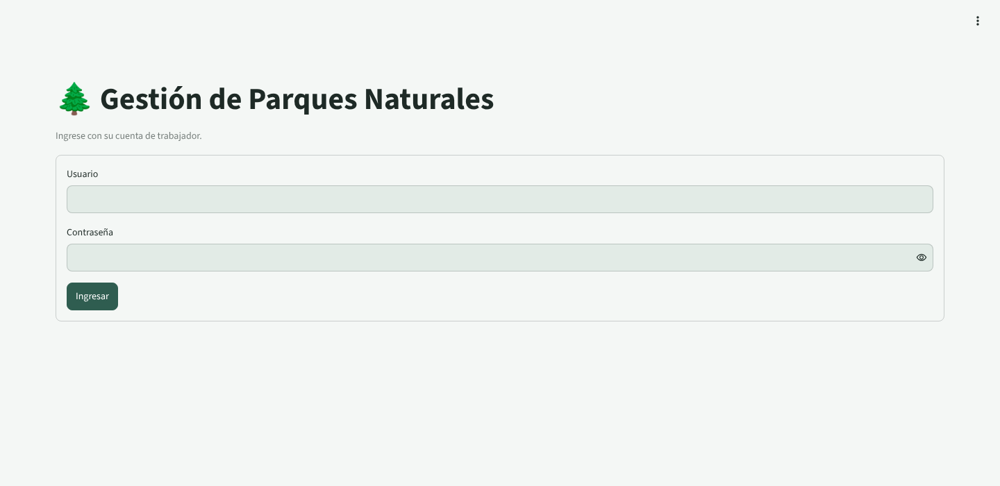

*Figura 1. Inicio de sesión.*

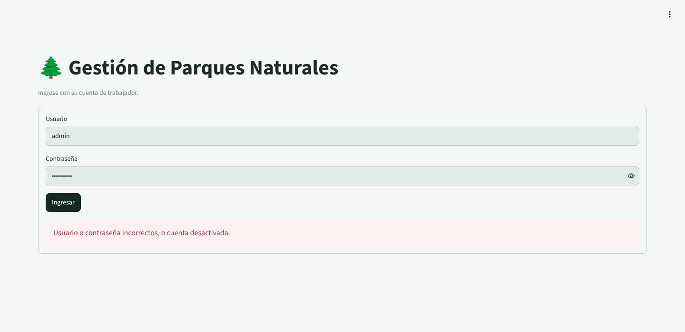

*Figura 2. Contraseña incorrecta: acceso rechazado.*

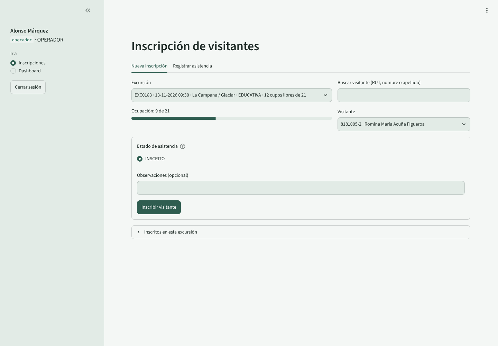

*Figura 3. Formulario transaccional (rol OPERADOR): excursión con cupos libres y ocupación, búsqueda de visitante y estado de asistencia.*

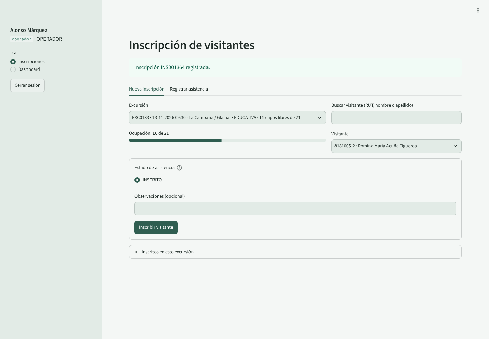

*Figura 4. Inscripción registrada (COMMIT): la ocupación pasa de 9 a 10 de 21.*

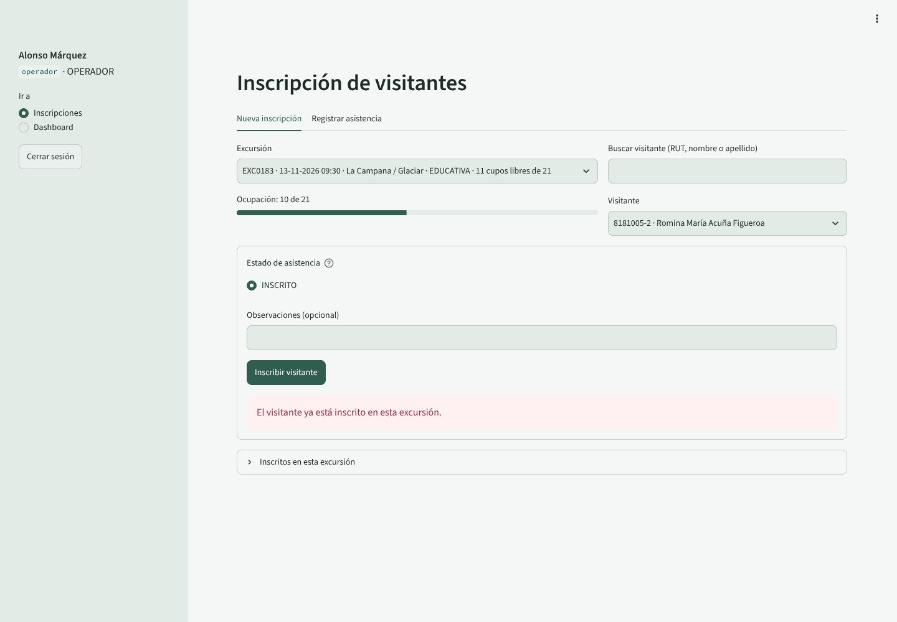

*Figura 5. El mismo visitante en la misma excursión es rechazado (regla 7, sin escribir en la base).*

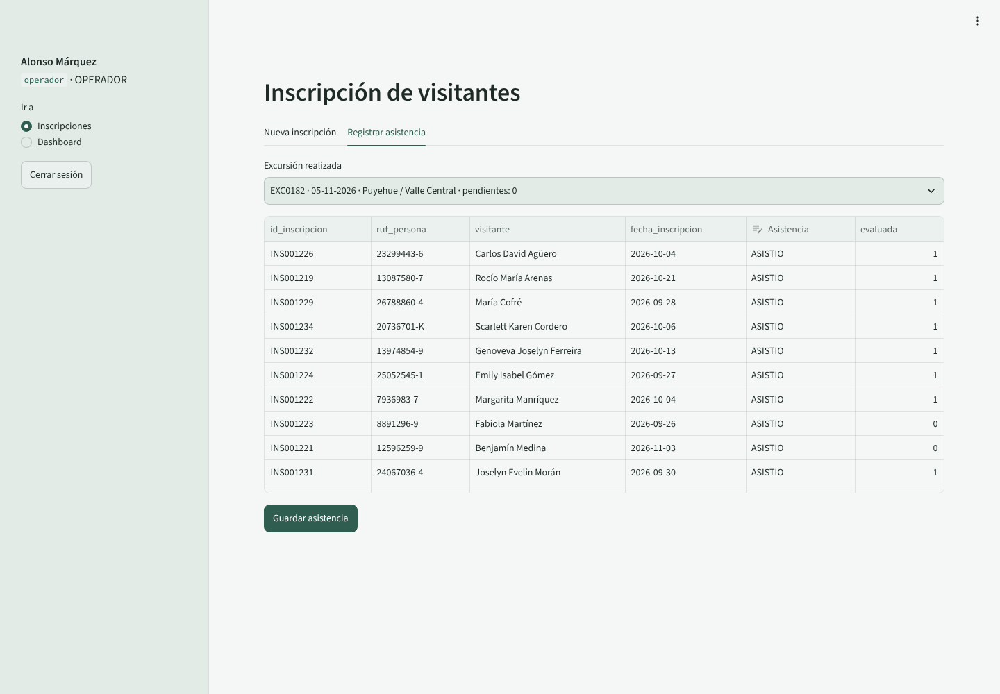

*Figura 6. Registro de asistencia de una excursión realizada (actualización transaccional).*

### 9.2 CRUD de tablas maestras

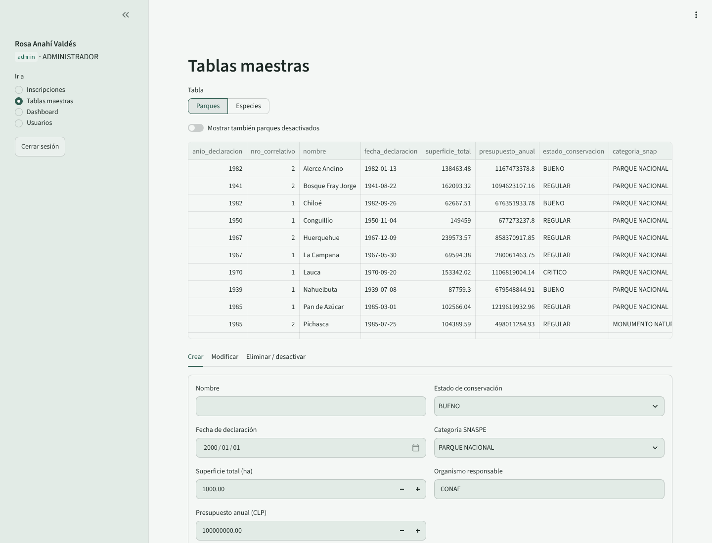

*Figura 7. CRUD Parque: consulta y formulario de creación (parque + región principal + primera área).*

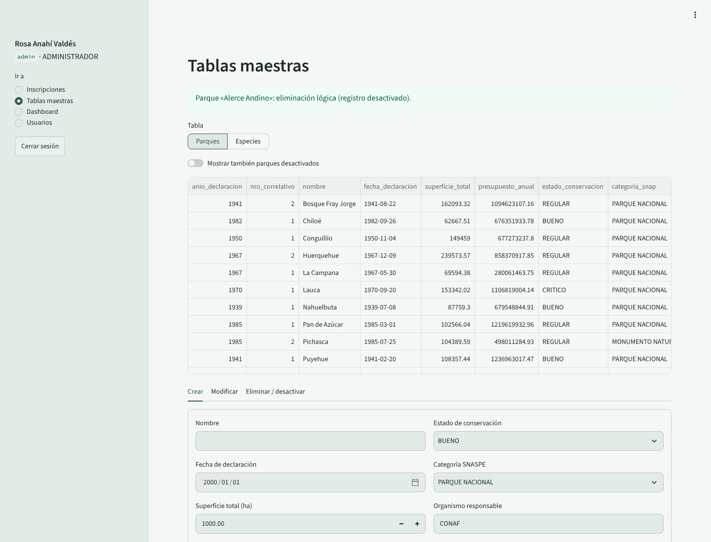

*Figura 8. CRUD Parque: un parque con historial se desactiva (eliminación lógica) y deja de aparecer en la lista de activos.*


*Figura 9. CRUD Especie: consulta con tipo, atributos del subtipo y registros de inventario.*

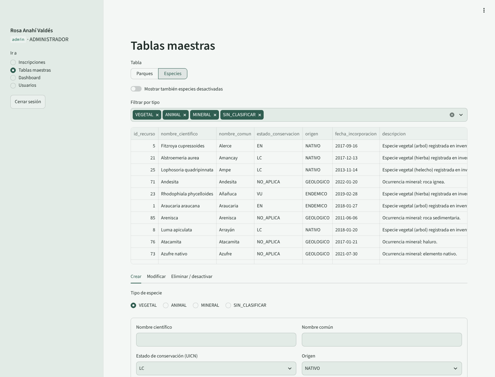

*Figura 10. CRUD Especie: creación con subtipo (VEGETAL, ANIMAL, MINERAL o SIN_CLASIFICAR).*

### 9.3 Usuarios y permisos por rol

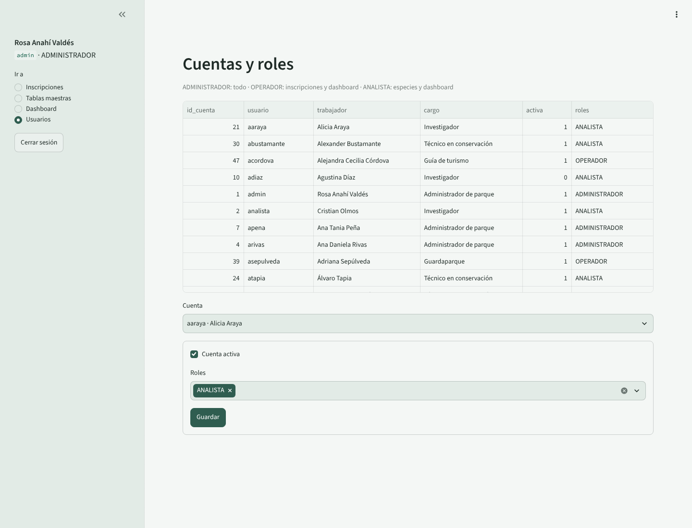

*Figura 11. Control de usuarios (solo ADMINISTRADOR): activar o desactivar cuentas y asignar roles.*

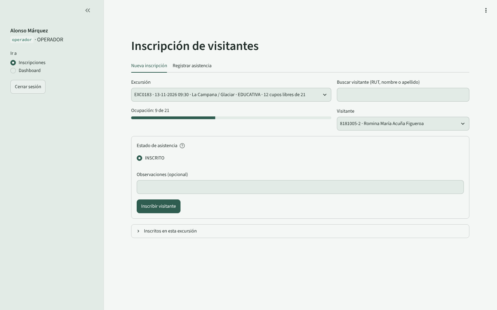

*Figura 12. Rol OPERADOR: el menú solo ofrece Inscripciones y Dashboard.*

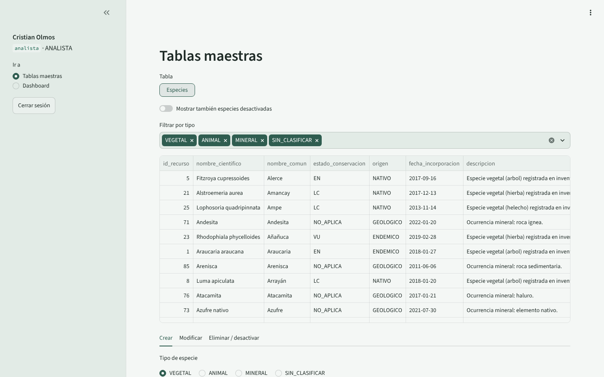

*Figura 13. Rol ANALISTA: sin inscripciones; en Tablas maestras solo ve Especies.*

### 9.4 Dashboard

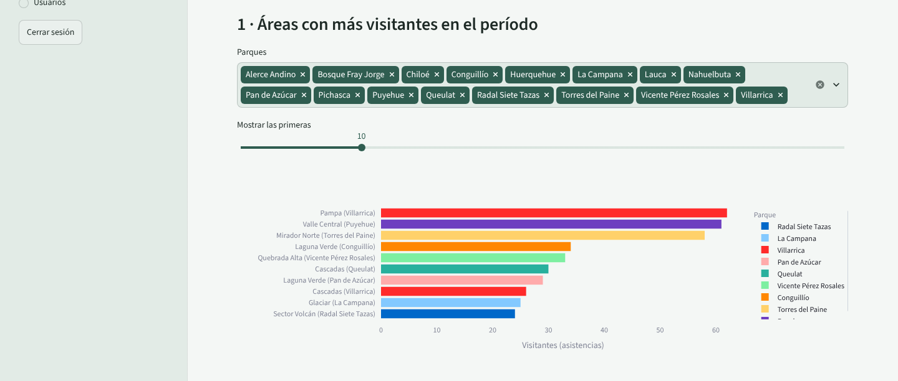

*Figura 14. Dashboard P1: ranking de áreas por visitantes, con filtros de fecha y parque.*

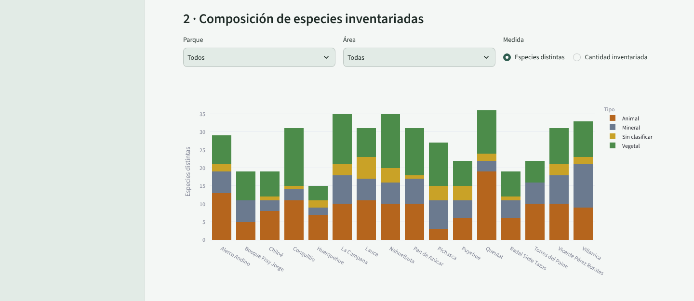

*Figura 15. Dashboard P2: composición vegetal/animal/mineral/sin clasificar por parque, con filtros de parque y área.*

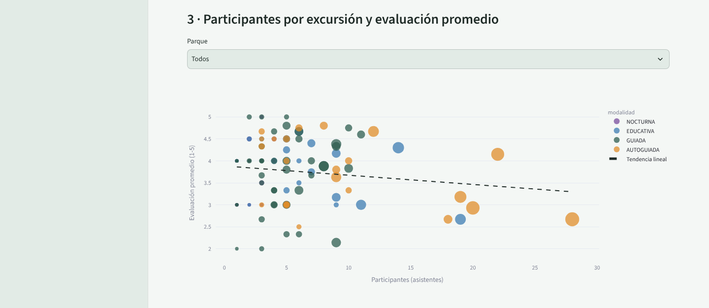

*Figura 16. Dashboard P3: dispersión participantes vs. evaluación promedio, con tendencia (pendiente negativa).*

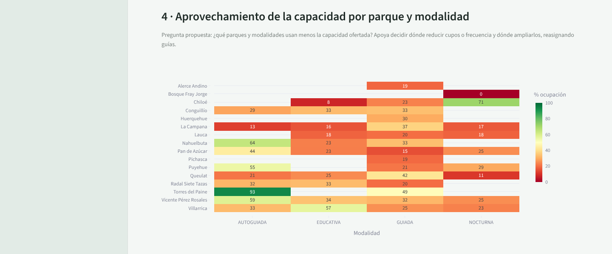

*Figura 17. Dashboard P4 (propuesta): ocupación de la capacidad por parque y modalidad; en rojo, donde sobran cupos.*

### 9.5 Apoyo con phpMyAdmin (opcional)

phpMyAdmin se usó como apoyo para revisar la base con el usuario de la aplicación. **No reemplaza las capturas de MySQL Workbench** que exigen las secciones 5 y 7.


*Figura 18. Estructura de parques_db: 24 tablas y 6 vistas.*


*Figura 19. Los 6 procedimientos almacenados.*


*Figura 20. Ejecución de CALL sp_r12_parques_sobre_promedio_general.*


*Figura 21. Una calificación 7 es rechazada por el CHECK ck_eval_calificacion.*


## 10. Plan de responsabilidades y participación del equipo

Propuesta **provisional** que cumple la sección 14 del PDF: cada integrante es responsable principal en tres actividades de etapas distintas, y cada funcionalidad del PMV tiene un responsable distinto. `[PENDIENTE: el equipo debe confirmarla o ajustarla antes de implementar, y debe ser consistente con las bitácoras.]`

| Etapa / actividad | Responsable principal | Integrantes que colaboran | Evidencia esperada |
|---|---|---|---|
| Revisión y corrección del MERE | Carlos Vasconcellos | Matias Lagos, Gaspar Galaz | MERE corregido (ERDPlus) y `docs/mere/correcciones_mere.md` |
| Modelo relacional final | Gaspar Galaz | Carlos Vasconcellos | Modelo Workbench validado (`.mwb` y PNG) |
| Implementación DDL | Gaspar Galaz | Esteban Gonzales | `sql/01_estructura.sql` y pruebas negativas |
| Poblamiento y calidad de datos | Esteban Gonzales | Francisca Perez | `scripts/generar_datos.py`, `sql/02_datos.sql`, conteos |
| Requerimientos R1-R3 | Matias Lagos | Francisca Perez | SQL, capturas Workbench e interpretación |
| Requerimientos R4-R6 | Francisca Perez | Matias Lagos | SQL, capturas Workbench e interpretación |
| Requerimientos R7-R9 | Carlos Vasconcellos | Gaspar Galaz | SQL, capturas Workbench e interpretación |
| Requerimientos R10-R12 | Esteban Gonzales | Carlos Vasconcellos | SQL, capturas Workbench e interpretación |
| Formulario transaccional PMV | Matias Lagos | Esteban Gonzales | Funcionalidad integrada y prueba |
| CRUD PMV | Gaspar Galaz | Francisca Perez | Funcionalidad integrada y prueba |
| Usuarios y roles | Esteban Gonzales | Carlos Vasconcellos | Funcionalidad integrada y prueba |
| Dashboard | Francisca Perez | Matias Lagos | 4 visualizaciones integradas |
| Integración y pruebas del PMV | Carlos Vasconcellos | Todos | PMV completo funcionando; `pytest` |
| Docker y despliegue | Matias Lagos | Gaspar Galaz | Contenedores e instrucciones (README) |
| Integración del informe | Francisca Perez | Todos | Informe final y evidencias |

## 11. Bitácoras individuales

Una por estudiante en `equipo/bitacoras/`. `[PENDIENTE: cada integrante registra sus actividades reales: fecha, actividad, etapa, evidencia, horas y resultado, más la síntesis final que pide la sección 15 del PDF. No se completan por adelantado.]`

## 12. Despliegue con Docker

**Servicios** (`docker-compose.yml`):

- `db` (imagen `mysql:8.0`): al primer arranque, con el volumen vacío, ejecuta `sql/00_integral.sql` desde `/docker-entrypoint-initdb.d/` y crea la base, las tablas, los datos, las vistas y los procedimientos. Expone el puerto 3307 del equipo para MySQL Workbench. Su healthcheck consulta `EVALUACION` por TCP, así que solo pasa cuando la carga terminó.
- `app` (imagen construida con el `Dockerfile` sobre `python:3.12-slim`): instala `requirements.txt`, copia la aplicación, corre con un usuario sin privilegios y expone Streamlit en el puerto 8501. Espera a que `db` esté sano.
- `phpmyadmin` (opcional): apoyo para revisar la base en el puerto 8090. No reemplaza a Workbench.

Las credenciales viven en `.env`, que no se sube al repositorio; `.env.example` muestra el formato.

```bash
cp .env.example .env            # editar contraseñas
docker compose up -d --build    # 1.ª vez: 1-2 min mientras se carga la base
docker compose ps               # db y app deben quedar "healthy"
# Navegador: http://localhost:8501   (usuario admin, contraseña Parques2026!)
# Workbench: 127.0.0.1:3307 con DB_USER / DB_PASSWORD
docker compose down -v          # detener y BORRAR la base (reconstruir desde cero)
```

`[PENDIENTE: insertar capturas docs/evidencias/docker_*.png]`

**Alternativa de desarrollo:** el repositorio incluye también un GitHub Codespace (`.devcontainer/`) que instala MySQL 8 y Python, crea la base y abre la aplicación sin Docker.

## 13. Conclusiones

### 13.1 Conclusión de cada integrante

`[PENDIENTE: cada integrante escribe en primera persona su aporte real, qué lideró, qué problema resolvió y qué aprendió. Debe coincidir con su bitácora y con la matriz.]`

- **Carlos Vasconcellos:** `[PENDIENTE]`
- **Matias Lagos:** `[PENDIENTE]`
- **Esteban Gonzales:** `[PENDIENTE]`
- **Gaspar Galaz:** `[PENDIENTE]`
- **Francisca Perez:** `[PENDIENTE]`

### 13.2 Conclusiones del proyecto

**Problemas encontrados y decisiones adoptadas**

- *R8 no tenía respuesta en el modelo de Fase 1*: la función era un atributo multivaluado sin lugar de trabajo. Se agregó la relación EJERCE_EN (`ASIGNACION_TRABAJADOR`), referenciando `TRABAJADOR_FUNCION` para que solo se asigne una función que el trabajador realmente tiene.
- *Coherencia evaluación–inscripción*: el informe de Fase 1 advirtió que una FK simple no lo garantizaba. Se resolvió con una FK compuesta `(id_inscripcion, codigo_excursion)`, sin triggers.
- *Restricción de MySQL*: un CHECK sobre una columna con acción referencial produce el error 3823; la regla de autosupervisión se trasladó a un trigger.
- *Duplicación en JOIN*: unir inscripciones y evaluaciones multiplica filas. En R3, R12 y el dashboard los conteos y promedios se calculan en subconsultas separadas; en R7 se usa COUNT(DISTINCT).
- *Tasas con muestras pequeñas*: áreas con 2 inscripciones mostraban 100 % de asistencia. La consulta de evidencia de R5 exige al menos 10 inscripciones.
- *Datos que no fueran triviales*: con datos uniformes todas las áreas se parecen. Se usaron popularidad por parque, estacionalidad, recurrencia de Pareto y calidad por excursión, de modo que las consultas muestran diferencias reales.
- *Eliminación con historial*: borrar un parque o una especie rompería FK; se adoptó desactivación lógica y eliminación física solo sin dependencias.

**Integración.** Una sola base alimenta todo: el script integral la reconstruye, el generador produce los datos, los procedimientos y vistas se ejecutan en Workbench, y el PMV usa las mismas tablas mediante consultas propias. Las reglas críticas se validan en la base (triggers y restricciones) y en la aplicación (mensajes claros).

**Distribución real del trabajo.** `[PENDIENTE: describir cómo se repartió de verdad y si difirió de la matriz.]`

**Uso de IA.** El borrador inicial del código y la documentación se produjo con un asistente de IA (Claude, de Anthropic). El enunciado exige **OpenCode** como herramienta del curso: el equipo debe usarlo para revisar, corregir y explicar el código, y registrar esa validación en `docs/uso_ia_validacion.md`. La IA no reemplaza la comprensión: cada integrante debe poder explicar cualquier sentencia en la defensa. `[PENDIENTE: completar con el uso real de OpenCode.]`
