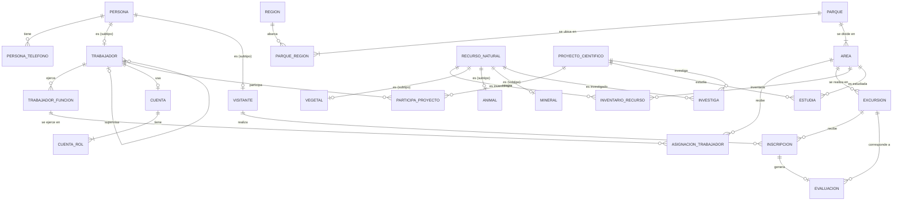

# Correcciones al MERE y al modelo relacional (Fase 1 → Fase 2)

> El MERE corregido está en `docs/mere/MERE_corregido.png` (fuente editable: `MERE_corregido.dot`). El modelo de Fase 1 está en `docs/fase1/`.
> **Pendiente:** si el docente entregó observaciones de Fase 1, agregarlas en `docs/fase1/observaciones_docente.md` y contrastarlas con esta lista. Las correcciones siguientes se derivan de los requisitos de Fase 2 (R1–R12 y PMV), no de observaciones recibidas.

## Resumen

Se conservan las 15 entidades, las 13 relaciones y las 23 tablas de Fase 1. Se agrega **una relación** (con su tabla) y se completan atributos y restricciones que la Fase 2 exige. Resultado: **24 tablas**.

| N.º | Cambio | Tipo | Motivo | Requisito que lo exige |
|---|---|---|---|---|
| C1 | Nueva relación **EJERCE_EN** entre TRABAJADOR (función) y AREA, con atributo `fecha_inicio`. Tabla `ASIGNACION_TRABAJADOR (rut_persona, funcion, anio_declaracion, nro_correlativo, nro_area, fecha_inicio)`, FK a `TRABAJADOR_FUNCION` y a `AREA`. | Relación N:M nueva | En Fase 1 la función era un atributo multivaluado sin lugar de trabajo: no se podía saber en qué parque o área se ejerce cada función. | R8 |
| C2 | CUENTA agrega `usuario` (UNIQUE), `password_hash` y `fecha_creacion`. | Atributos | Sin credenciales no hay inicio de sesión. La contraseña se guarda con hash PBKDF2-SHA256, nunca en texto plano. | PMV · control de usuarios |
| C3 | PARQUE y RECURSO_NATURAL agregan `activo` (lógico, por defecto verdadero). | Atributo | Un parque o especie con historial no puede borrarse sin violar integridad: se desactiva. | PMV · CRUD |
| C4 | EVALUACION referencia `(id_inscripcion, codigo_excursion)` de INSCRIPCION (FK compuesta, con UNIQUE de apoyo en INSCRIPCION). | Restricción | En Fase 1 se reconoció que una FK simple no garantizaba que la evaluación fuera de la misma excursión que la inscripción. | Regla 8 y 9 |
| C5 | PARQUE_REGION agrega la columna generada `principal_unica` con UNIQUE `(anio, correlativo, principal_unica)`. | Restricción | Impide dos regiones principales por parque. | Regla 5 |
| C6 | Triggers: cupo de excursión, asistencia solo en excursiones realizadas, evaluación solo con asistencia y fecha ≥ excursión, especialización disjunta de RECURSO_NATURAL, sin autosupervisión. | Restricciones | Reglas que una FK o CHECK no puede expresar en MySQL. | Reglas 7, 9, 12, 16 y formulario |
| C7 | Dominios cerrados con CHECK: `estado_asistencia` (INSCRITO, ASISTIO, NO_ASISTIO), `nivel_acceso`, `estado_operativo`, `modalidad`, `funcion`, `rol`, `estado_conservacion`, `categoria_snap`, etc. | Restricciones | Evitan valores libres que rompen agrupaciones (R2, R5, R8, R10). | R1–R12 |
| C8 | Nombres sin tilde ni «ñ» en identificadores: `año_declaracion` → `anio_declaracion`, `dureza_Mohs` → `dureza_mohs`, `categoria_SNAP` → `categoria_snap`. | Nomenclatura | Portabilidad entre sistemas operativos y herramientas (Workbench, Python). | — |

## Reglas de negocio nuevas o modificadas (sección 3 del informe)

17. Cada función que ejerce un trabajador se desarrolla en una o más áreas; cada área puede tener varios trabajadores por función (C1).
18. Una cuenta tiene un nombre de usuario único y una contraseña almacenada con hash; solo las cuentas activas inician sesión (C2, modifica regla 10).
19. Los roles válidos son ADMINISTRADOR, OPERADOR y ANALISTA; cada cuenta tiene al menos uno (precisa la regla de CUENTA_ROL).
20. Una excursión no admite más inscripciones que su capacidad (C6).
21. El estado de asistencia es INSCRITO hasta la fecha de la excursión; desde ese día puede pasar a ASISTIO o NO_ASISTIO (C6).
22. Solo una inscripción con estado ASISTIO puede generar una evaluación, con fecha igual o posterior a la excursión (C6, precisa la regla 9).
23. Un parque o especie con registros asociados no se elimina: se desactiva (C3).
24. Las excursiones se programan solo en áreas con nivel de acceso PUBLICO o RESTRINGIDO (regla aplicada en los datos; las áreas PROTEGIDO se reservan a conservación e investigación).
25. «Comunidades administradoras» del enunciado corresponden a REGION (adaptación territorial chilena de Fase 1); la participación territorial se registra en PARQUE_REGION.porcentaje_territorial.

## Especializaciones (sin cambios respecto de Fase 1)

- **PERSONA → {TRABAJADOR, VISITANTE}:** total y solapada. En los datos, 12 trabajadores también son visitantes; ninguna persona queda sin subtipo (verificado en `sql/05_pruebas.sql`).
- **RECURSO_NATURAL → {VEGETAL, ANIMAL, MINERAL}:** parcial y disjunta. 12 recursos (hongos, líquenes y algas) quedan sin clasificar; los triggers `trg_*_disjunto` impiden que un recurso pertenezca a dos subtipos.

## Modelo relacional final (24 tablas)

El detalle de columnas, tipos, PK, FK, NOT NULL, UNIQUE y CHECK está en `sql/01_estructura.sql`, que es la fuente para generar el diagrama en MySQL Workbench (ver `docs/workbench/instrucciones_workbench.md`).
